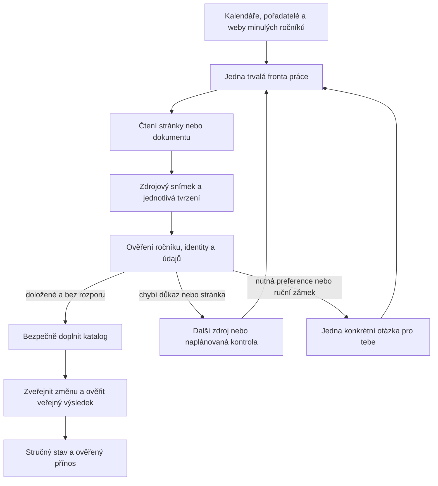

# LetsRace: samostatný provoz a minimum ruční správy

**Historický návrh z 1. listopadu. Nejde o aktuální stav nasazení.** Dokončené a otevřené úkoly jsou ve [společném seznamu priorit](operations-progress.md).

Stav ověřený 1. listopadu 2026 přibližně ve 23:29–23:33 Europe/Prague. Toto je **návrh budoucího řešení a plán realizace**, nikoliv oznámení jeho nasazení. Při přípravě se neměnila data závodů, nastavení služeb ani rozpočet a nespouštěla placená AI.

## Rozhodnutí

**Doporučuji variantu 2: jednoduchý přehled a schránku skutečných rozhodnutí. Současnou administraci odstranit z běžného používání, technické nástroje zachovat pro automatiku a servis. Panel na Macu zmenšit na stav a přístup do stejné schránky.**

Ty běžně nic nekontroluješ a nic nespouštíš. Systém hledá, ověřuje, doplňuje a obnovuje práci sám. Ozve se při potřebě tvé preference, souhlasu s novým výdajem nebo změny tvého dřívějšího ručního rozhodnutí. Neoznamuje každé nepřečtení stránky.

| Možnost | Posouzení |
|---|---|
| Úplně odstranit administraci i možnost zásahu | Nedoporučuji. Zůstávají ruční zámky, rozpočty a výjimečné případy. Bez přehledu by problémy pouze zmizely z očí. |
| Přehled + schránka rozhodnutí | **Doporučená varianta.** Odpovídá tomu, že aplikaci nechceš provozně obsluhovat. Vnitřní nástroje mohou zůstat podstatně podrobnější. |
| Kompletně přepracovat velkou administraci | Nedoporučuji jako hlavní projekt. I lepší tabulky by od tebe dál vyžadovaly práci, kterou má převzít automatika. |

Zrušení navigace samo nestačí. Největší práce je dokončit automatické zpracování důkazů, sjednotit pravidla mezi serverem a Macem a ověřovat skutečný výsledek na veřejném webu.

## 1. Co dnes skutečně běží

Ověřený produkční commit je `63809b77`; poslední nasazení `dpl_42cPvAKBdqkhjSBSqKT2wa5agn8Z` je READY. Soukromá kopie na Macu se u správce, hlavního sběru, finančních pravidel a zapisovače shoduje s pracovním projektem. Starší rozpracované reporty a změny AGENTS.md nejsou důkazem nasazení.

| Část | Skutečný stav | Omezení |
|---|---|---|
| Serverové čtení | Denně v 05:00 UTC; 1. 11. tedy v 06:00 českého času. Nejvýše 60 zdrojů a časový limit jednoho běhu. | Samo nenahradí všechen místní sběr. Nulový počet splatných zdrojů může být správný výsledek. |
| Údržba katalogu | Denně v 05:15 UTC, doplňování, minulý ročník, dokončení minulých termínů a také automatické slučování. | Není totožná s místním postupem. Některé kategorie doplňuje odhadem; takový údaj není nově potvrzená informace. |
| Mac | Správce běží, další běžný cyklus plánuje dvě hodiny po dokončení předchozího. | Po vypnutí Macu místní práce čeká. Zavření panelu správce nezastaví. |
| Chrome / ČSC | Týdenní místní sken v pondělí od 09:00 a ruční spuštění. Poslední skutečný sken přečetl 424 řádků, skončil úspěšně. | Tato cesta potřebuje Mac a prohlížeč. Nejde o sken federací všech zemí. |
| AI | Místní automatické pokusy v úterý a pátek, společný místní limit 0,50 USD/den a 5 USD/měsíc. | Nejde o průběžného samostatného správce všech čekajících případů. Značka pokusu dne není totéž co dokončená práce. |
| Serverová AI | Produkční nastavení skutečně obsahuje vypnuté modelové čtení a nulové modelové rozpočty. | Přesun AI na server nyní není součástí doporučené první realizace. |
| Hledání | Bezplatné hledání a odkazy ze zdrojů běží; dotazy pokrývají aktuální i příští rok. Samostatné dvouposkytovatelové hledání má vlastní nástroj. | Placené hledání je vypnuté. Samostatný výzkumný nástroj není pravidelný automatický ověřovatel fronty. |
| Upozornění | Existuje panel a kód provozních webhooků. | V kontrolované místní konfiguraci ani mezi produkčními proměnnými není provozní webhook nastavený. Existence kódu není doručené upozornění. |

### Výchozí čísla a jejich přesný význam

Zdroj: aktuální čtení produkční databáze, stav místního správce a produkční konfigurace. Snímky jsou v `reports/operations-autonomy-plan-2026-11-01/`.

| Měřená veličina | Stav | Co z ní nelze vyvozovat |
|---|---:|---|
| Aktivní sledované zdroje | 1 439 | Nejde o počet závodů ani pokrytí trhu. |
| Zdroje čekající na schopnější čtení | 393 | Ne všechny potřebují AI; někdy pomůže běžná čtečka nebo jiný dokument. |
| Aktuální zdroje s jinou chybou | 2 | Eventiv vyžaduje přihlášení; místní čtečka neověří certifikát Chotěbuze. |
| Čtení za 24 hodin / neúspěšné řádky běhů | 1 213 / 497 | Z toho 400 nepodporovaných a 20 nedostupných dynamických čtení; zbytek zahrnuje historii síťových chyb i již opravené případy. Není to 497 rozbitých zdrojů. |
| Nedokončené běhy z tohoto 24hodinového okna | 0 | Neprokazuje to úplnost načtení každého kalendáře. |
| Čekající podklady / návrhy webů | 19 / 14 | Automatika je nemá všechny převést na otázky pro tebe. Nejstarší podklad vznikl 25. 10., nejstarší návrh webu 24. 10. |
| Veřejné nesloučené záznamy od 1. 11. v sedmi zemích | 1 203 | Jde o definovaný databázový soubor bez dalších filtrů UI, nikoliv nezávisle ověřené závody nebo úplnost sezony. V tomto snímku mají všechny stav scheduled. |
| Z nich bez webu i přihlášky | 103 | Mohou mít jiný zdrojový odkaz; neznamená to automaticky nepravdivý závod. |
| Z nich bez standardního snímku source_evidence | 74 | Některé mají jiné ruční důkazy; chybějící tento typ záznamu není důkaz chybného data. |
| Označení věkových kategorií v tomtéž souboru | 704 explicit, 15 previous, 336 default, 148 bez označení | Jsou to uložené štítky, nikoliv nezávislá kontrola správnosti. Odhad nesmí vstupovat mezi nově ověřené údaje. |

Místní souhrn uvádí 89 nově založených záznamů a 1 321 změn za 24 hodin. Tato čísla zatím nepoužiji jako „89 ověřených unikátních nových závodů“ a „1 321 ověřených informací“. Chybí stejné vymezení napříč běhy a kontrola výsledné identity.

### Kde vzniká ruční práce nebo falešná jistota

| Krok | Dnes | Konkrétní mezera a navržená změna |
|---|---|---|
| Hledání | Odkazy z kalendářů a bezplatné vyhledávání, samostatný výzkum | Není průběžně měřeno, které země a disciplíny nejsou pokryté. Přidat cílené hledání chybějících ročníků a řízení podle nezávislých seznamů. |
| Čtení | Specializované čtečky, obecné čtení, textové PDF, někde Chrome a AI | 393 čekajících zdrojů nemá automaticky zajištěný další schopný krok. Úloha musí znát potřebnou schopnost a důvod čekání. |
| Ověření | Kontroly data, identity, země, zdrojových citací a ručních rozhodnutí již existují | Samostatné objevené podklady se předávají k explicitnímu rozhodnutí, ale ve spuštěných pravidelných krocích není univerzální ověřovatel, který je postupně vyřeší. |
| Doplnění | Zapisovač chrání ruční zámky a přesnější údaje, uchovává zdrojová tvrzení | Pravidla jsou rozdělená mezi hlavní zapisovač a řadu doplňovacích úloh. Záruku stejné ochrany nelze odvodit pouze z existence jednoho bezpečného zapisovače. |
| Zveřejnění | Běžné čtení může zapisovat automaticky; samostatný výzkum zůstává k ověření | Potřeba jedné společné publikační podmínky bez ohledu na cestu, kterou informace přišla. |
| Veřejný výsledek | Běžné čtení nepřekresluje všechny veřejné stránky, jejich data mohou čekat na týdenní obnovu; některé zásahy obnovu vyvolají | Uložená oprava nemusí být vidět. Přidat cílené zveřejnění změněného závodu a následné porovnání skutečné veřejné odpovědi. |
| Důvěryhodnost | Veřejný ukazatel se odvozuje mimo jiné z přítomnosti přihlášky/webu; datum posledního nalezení se může posunout při nezměněné odpovědi | Odkaz není ověření a poslední čtení není kontrola každého údaje. Zobrazovat původ a jistotu konkrétních informací. |
| Duplicity | Hlavní zapisovač páruje; Mac má slučovací krok obvykle jen jako náhled; serverová údržba slučuje automaticky | Sjednotit povolení a podmínky slučování v jednom místě. Podobnost názvu ani důvěra modelu nesmějí samy rozhodnout. |
| Provoz | Místní souhrn již odděluje limity čtečky | Serverové sledování chyb stále v části kódu počítá všechny neúspěšné výsledky stejně. Stav „běží“ zatím nezohledňuje kvalitu a stáří nevyřešené práce. |

## 2. Co budeš používat ty

Jediná stránka **Stav LetsRace** a jednoduché zobrazení téhož stavu v liště Macu. Žádné samostatné sekce pro federace, zdroje, modely, duplicity a doplňování údajů v běžném pohledu.

Příklad obsahu níže je návrh textů. `[N]`, `[M]` a `[čas]` jsou zástupné hodnoty, nikoliv naměřené výsledky.

```text
LetsRace
Vše běží

Za posledních 7 dní:
Přidáno [N] ověřených ročníků závodů
Ověřené údaje doplněné u [M] závodů

Nic od tebe nepotřebuji.
Poslední kontrola provozu: [čas]

[Otevřít přehled]
```

Do standardního panelu nedávat tlačítka „spustit AI“, „sken federace“, „obnovit server“ a výpisy jednotlivých běhů. Jejich případné servisní varianty budou v pokročilých nástrojích. Zůstane **Pozastavit automatiku**, s jasným vysvětlením, zda se pozastavuje sběr na Macu nebo celý systém; žádná skrytá nejednotná pauza.

### Čtyři srozumitelné situace

| Situace | Text pro tebe | Chování |
|---|---|---|
| Běžný provoz | „Vše běží. Nic od tebe nepotřebuji.“ | Zobrazit jen ověřený přínos a čas kontroly. Žádné pravidelné vyrušování. |
| Probíhá práce | „Ověřuji nové termíny a doplňuji závody.“ | Žádný odhad času bez podkladů. Nezobrazovat deset technických etap. |
| Automatické zotavení | „Jeden zdroj dočasně neodpovídá. Další kontrola dnes večer; zatím nemusíš nic dělat.“ | Konkrétní další krok a dopad. Při běžném pokusu bez upozornění. Pokud zpoždění překročí cíl, stav „Doplňování se zpožďuje“, i když proces stále běží. |
| Potřeba rozhodnutí | „Potřebuji jedno rozhodnutí: pořadatel změnil termín závodu, který máš ručně uzamčený.“ | Jedna karta: co se mění, dosavadní a nový údaj, zdroj, doporučení, nejvýše dvě možnosti a důsledek neodpovědi. |

„Čeká na zveřejnění termínu“, „čeká na další rozpočet“ a „potřebuje technickou opravu“ nepatří automaticky do schránky tvých rozhodnutí. Jsou to stavy práce systému.

Zelený stav dovolíme jen při čerstvém hlášení, funkčních zápisech a nepřekročených cílech důležitých úloh. Samostatně zůstane krátká informace „U některých závodů ještě pořadatel nepotvrdil údaje“. Zelená nebude tvrdit úplné pokrytí nebo bezchybnost všech dat.

V přechodném rozhraní nesmí být text „AI to řeší“, dokud skutečně neexistuje převzatá úloha, dostupná schopnost a další krok. Do té doby přehled poctivě řekne „Tato část ověřování ještě není automatizovaná“. Zjednodušení rozhraní nesmí předběhnout dokončení automatiky a zakrýt zbývající práci.

### Co s Macem

Panel zachovat jako **tenkého klienta a místního pomocníka**, nikoliv další řídicí centrum. Potřebuje ho místní prohlížeč a zatím i modelové čtení. Server má uchovávat společný stav, úlohy a výsledky. Když je Mac vypnutý, práce se neztratí; dostupné běžné čtení pokračuje na serveru, prohlížeč a místní AI mají výslovně odložené úlohy. Po návratu se berou podle naléhavosti, ne po všech zdrojích znovu.

Text v přehledu při vypnutém Macu: „Běžné kontroly pokračují. Část ověřování počká na Mac.“ Nezobrazovat všechno jako zdravé ani celý systém jako vypnutý. Prohlížeč provozovat v odděleném profilu s hlídáním pádu a neúplného načtení; nespoléhat na náhodně otevřenou kartu.

Výchozí upozornění: místní oznámení a počet skutečných rozhodnutí u ikony. Kritické upozornění při vypnutém Macu vyžaduje jeden předem zvolený a ověřený vzdálený kanál. Doporučuji jeden ověřený e-mail pro vlastníka, bez příloh a osobních dat. Nyní není zapnutý; žádné zprávy se v rámci tohoto plánu neposílají. Stav a rozhodnutí zůstávají vždy dostupné na webu.

## 3. Cílové fungování



### Jedna fronta, dvě místa vykonávání

V Supabase zavést společné trvalé úlohy nad existujícími registry zdrojů a kandidátů. Nesmí vzniknout další nezávislá fronta stejných adres: během přechodu původní plánování převést na adaptéry, po přepnutí mu odebrat samostatné řízení splatnosti. Mac a server si práci přebírají ze stejného místa; každá úloha má časově omezené převzetí a obnovitelné pokračování.

Úloha musí mít druh práce, zdroj nebo ročník, prioritu, potřebnou schopnost, další termín, počet pokusů, uložený výsledek, důvod čekání, původ a verzi pravidel. Čtení jednoho dokumentu vytváří více tvrzení; stránka se kvůli deseti závodům nečte desetkrát. URL se sjednocují bez ztráty významových parametrů a ročníků.

Priorita: **zrušení/přesun a rozpory závodů v nejbližších dnech → ověření nového konkrétního ročníku → doplnění zásadních údajů → širší hledání → historické detaily.** Část kapacity musí zůstat menším zemím a disciplínám; jeden velký kalendář nesmí spotřebovat všechno.

### Běžná čtečka, prohlížeč, AI

1. Nejprve strukturované kalendáře, běžné stránky a textové PDF. Jejich výsledek také prochází kontrolami.
2. Prohlížeč jen tam, kde běžná stránka nemá potřebný obsah nebo kde je pro něj ověřený přínos. Sken nesmí označit deset načtených řádků za kompletní kalendář.
3. AI čte konkrétní dostupný dokument, tabulku, obrázek či rozpor. Výstup musí odkazovat na skutečně přečtenou část zdroje a projít kontrolami mimo model.
4. Nečitelný dokument jde k jinému způsobu čtení nebo na pozdější kontrolu. Přihlášení a certifikáty nejsou problém, který AI vyřeší vymyšlením obsahu.

AI nebude samostatně rozhodovat SQL zápisem. Dostane omezené nástroje pro práci se zdroji a návrh konkrétní změny. Zápis provede společná kontrolovaná cesta, která nepotřebuje modelu zpřístupnit osobní plány, přihlašovací údaje nebo libovolné příkazy.

## 4. Pravdivost po jednotlivých údajích

U každého důležitého údaje uchovávat: původní tvrzení, URL a snímek dokumentu, doslovný podklad nebo strukturovaný řádek, konkrétní ročník/kolo, čas přečtení, čas skutečného ověření, způsob čtení, míru přesnosti, autoritu zdroje pro tento údaj a případnou platnost ručního rozhodnutí.

Rozlišovat stavy **potvrzené**, **převzaté z minulého ročníku**, **předběžné**, **sporné** a **neznámé**. Pouhé stažení nezměněné stránky nesmí měnit „ověřeno“ u všech polí. Užitečné stávající zdrojové důkazy a historie se znovu nevytvářejí od nuly.

| Údaj | Pravidlo výběru |
|---|---|
| Datum a stav závodu | Jedno výslovné oznámení pořadatele, relevantní federace/seriálu nebo jiného ověřeného autoritativního zdroje může stačit. Dva přebírající agregátory nejsou dva nezávislé důkazy. Rozdílné datum mezi dvěma autoritami vede k cílenému dohledání; ne k výběru podle vyššího sebevědomí modelu. |
| Místo | Ověřit místo konkrétního kola. Sídlo federace není místo závodu; obec nebo země není přesná startovní čára. Souřadnice mají přesnost. |
| Kategorie | Přednost mají propozice daného ročníku a skutečné podmínky účasti. Dětský program není důkaz dětského závodu. Odhad z názvu zůstává odhadem. |
| Trasy a délky | Údaje se vztahují ke konkrétní variantě a ročníku. Předběžná trasa nesmí být vydaná za definitivní. |
| Přihláška | Ověřit cíl a příslušnost k ročníku. Existence odkazu neprokazuje otevřenou registraci, kapacitu ani cenu. |
| Zrušení/přesun | Vyžadovat explicitní tvrzení spojené s danou soutěží. Zmizení z jednoho neúplně načteného seznamu závod nezruší. Uplynulé datum samo neprokazuje, že se akce skutečně uskutečnila. |

Neznámá informace nesmí bránit zveřejnění jinak doloženého závodu, pokud není nezbytná pro jeho identitu a správný kalendářový termín. Nedoplňovat všechna pole jen kvůli vyššímu procentu vyplněnosti.

### Nové ročníky

Vycházet z posledního ověřeného ročníku, ale ponechat jej samostatně. Projít i homepage, novinky a přihlášky; navigace se starým rokem není důkaz, že nové oznámení neexistuje. Společný web načíst jednou a jednotlivé termíny přiřazovat ke konkrétním kolům.

Po explicitním oznámení nového data lze nový ročník publikovat bez čekání na kompletní propozice. Stabilní identitu, disciplínu, obecné zařazení a místo převzít s původem; nové změny mají přednost. Staré kategorie označit `previous`. Nekopírovat staré výsledky, zrušení, otevření přihlášek, poplatky, termíny, limity ročníků narození a staré dokumenty jako aktuální.

Výslovně oznámený ročník bez dne uchovat jako rozpracovaný ročník s neznámým datem. Neukládat falešný 1. červen nebo stejnou sobotu jako loni. Pokud později dostane veřejnou stránku, nesmí se objevit v kalendáři pod vymyšleným dnem a nezapočítá se mezi ověřené termíny.

### Bezpečný zápis a skutečné zveřejnění

Každá čtečka i doplňovací úloha předá návrh stejné publikační kontrole. Zápis konkrétní revize závodu, jeho zdrojů, důvodů změn a navazující práce musí být transakční a opakovatelný bez druhého závodu. Změnil-li se od přípravy návrhu záznam nebo zámek, návrh se znovu vyhodnotí.

Po zápisu se cíleně obnoví příslušný detail a dotčené přehledy; ne všechny stránky při každém přečtení. Následně se ověří odpovídající veřejná revize, datum, stav a odkazy. Stav „hotovo“ vznikne až potom. Při problému se opakuje zveřejnění, nikoli znovu samotné založení závodu.

## 5. Duplicity a ochrana historie

Prověřovat veřejné, skryté i dříve sloučené záznamy. Pracovat s ročníkem, místem, pořadatelem, disciplínou, typem soutěže, kolem a identifikátorem zdrojového záznamu. Sdílená URL pořadatele sama nestačí. Rozdílný den může znamenat přesun nebo starou chybu; automaticky nevytvářet druhý závod jen kvůli změně data.

**Automatické přiřazení/sloučení je možné pouze při jednoznačné identitě konkrétního ročníku a bez tvrdého rozporu.** Dvě nezávisle přijatá tvrzení téhož zdrojového záznamu lze spojit; podobné názvy, stejný den a obec nebo modelový odhad samy nestačí. Respektovat rozhodnutí „samostatné závody“ a ruční zámky. Jedno víkendové setkání, samostatná časovka a různé trasy nejsou automaticky stejná věc.

Před sloučením vybrat stabilní záznam podle vztahů a podkladů, zachovat další údaje i nesouhlasná tvrzení. Ponechat stará ID/adresy jako přesměrování a převést zdroje, kategorie, seriály a vztahy uživatelů. Použít existující obnovovací snímky; při pozdějších změnách uživatelských plánů se návrat nesmí provést slepým přepsáním.

Pravidelný průchod má nejprve hledat nové podezřelé páry mezi změněnými záznamy. Po potvrzení identity opravit i zdrojové přiřazení, aby se duplicita nevracela. Rozhodnutí uchovávat podle skutečných tvrzení, ne podle proměnlivé patičky webu. Nový zásadní důkaz může případ otevřít znovu; změněná navigace ne.

Regresní sada: Kendenich/RaceHub záložky, L’Etape aliasy, legitimní víkend versus Mediofondo Sudet, různé trasy, děti versus dospělí, různé země se stejným názvem obce, různé ročníky a akce přes Nový rok, znovupoužitý identifikátor pro jiné kolo, ruční „neslučovat“ a původní plán uživatele.

## 6. Co vyřeší systém a co opravdu potřebuje tebe

| Samostatně vyřešit a zkontrolovat | Samostatně odložit a vrátit se | Předložit tobě |
|---|---|---|
| Doložený nový termín, jednoznačné doplnění chybějícího webu či kategorie, opakování po výpadku, výběr schopnější čtečky, shodu téhož ročníku podle schválených pravidel | Neoznámené datum, rozpor autorit bez rozhodujícího důkazu, nedostupné propozice, dočasné omezení webu, vyčerpaný rozpočet, nedostupný Mac | Změnu tvého výslovného ručního zámku, rozšíření produktového rozsahu mimo dosavadní pravidla, nový výdaj, připojení soukromého účtu nebo souhlas s kontaktováním třetí strany |

„Je pravdivé datum na tomto webu?“ není vhodná otázka pro tebe. AI má dohledat další podklady nebo počkat. Nemá převést svou nejistotu na tvoje potvrzování každého závodu.

Příklady otázek, které mohou mít smysl:

| Otázka | Doporučení | Když neodpovíš |
|---|---|---|
| „Pořadatel oznámil jiný den než tvůj ručně uzamčený termín. Mám změnu přijmout?“ | Nabídnout nový den se zdrojem a historií. | Zámek zůstane. Rozpor nesmí být veřejně prezentovaný jako jistý termín; zobrazit upozornění na ověřování v mezích schválených pravidel. |
| „Chceš upozornění i při vypnutém Macu na ověřený kontaktní e-mail?“ | Ano, jeden kanál, pouze podstatné změny a skutečná rozhodnutí. | Web a místní panel dál fungují, nic se na nový kanál neposílá. |
| „Má smysl zaplatit vyšší limit na základě změřeného přínosu?“ | Předložit počet dalších ověřených závodů, cenu a alternativu zdarma. | Zůstává 5 USD/měsíc a 0,50 USD/den. |
| „Chceš připojit účet pro nepřístupný Eventiv?“ | Nejprve využít dostupné pořadatelské/federační zdroje, účet nepřipojovat bez doloženého přínosu. | Zdroj zůstane omezený a automatika používá ostatní zdroje. |

Nyní pro dokončení plánu žádný vstup nepotřebuji. Tyto otázky jsou návrhy budoucího rozhraní, nikoliv žádosti o okamžité schválení. Automatika nesmí sama kontaktovat pořadatele nebo žádat o přihlášení jménem vlastníka.

### Opakování a zotavení

- Dočasné síťové chyby: nejprve automatické pokusy přibližně za 15 minut, hodinu, šest hodin a den, s rozptylem a respektem k omezení webu. Konkrétní interval se řídí naléhavostí závodu.
- Nedostupná schopnost: úloha čeká na prohlížeč/OCR/Mac; nevrací se stále ke stejné neúspěšné čtečce.
- Chybějící oznámení: další kontrola za 7–14 dní, bližší termín častěji. Změna stránky ji může spustit dřív.
- Vyčerpaný rozpočet: přesný další možný termín; žádné opakované placené pokusy nebo stav poruchy jen kvůli limitu.
- Opakovaně špatný parser či hromadná chybná změna: pozastavit dotčenou cestu, ponechat dosavadní data, servisní případ zpracuje AI/agent. Celý katalog se kvůli jednomu webu nezastaví.
- Pád po zápisu: trvalý výsledek a klíč konkrétní změny umožní pokračovat od posledního potvrzeného bodu. Obnovení nesmí vytvářet duplicity.

## 7. Náklady a kapacita

**Zachovat 0,50 USD/den a 5 USD/měsíc pro modelová volání. Placené hledání ponechat vypnuté.** Modelové čtení zatím ponechat na Macu; Vercel a Supabase využít pro stávající veřejný web a společné řízení. Nezavádět nového placeného provozovatele jen kvůli novému přehledu.

Navržené rozdělení měsíčního limitu: do 4 USD běžné ověřování s průběžným čerpáním podle zbývajících dní a 1 USD rezerva pro důležité rozpory a přesuny. Jsou to části stejného limitu, nikoliv další peníze. Denní strop platí i pro rezervu. Nepotřebnou rezervu lze ke konci měsíce uvolnit podle pravidel. Pevné úterý/pátek nahradit prioritou čekajících úloh a dostupným rozpočtem.

Před každým voláním rezervovat maximální předpokládanou cenu; po výsledku vyúčtovat. Při pádu počítat s možným účtováním. Místní ledger již část ochrany má. Před případným budoucím spuštěním AI na více strojích musí rezervace rozpočtu být společná a transakční; několik souborů se stejným názvem není společný limit.

Z 393 čekajících zdrojů nelze bez měření slíbit, že je AI za 5 USD přečte všechny. První pilot změří cenu, délku dokumentů, znovupoužití jednoho čtení pro více kol a počet skutečně ověřených změn. Návrh má upřednostnit přínos na jednu korunu, ne počet modelových požadavků.

Dodatečný výdaj za nové služby je v první realizaci cíleně **0 USD**, není to záruka nezměněné faktury stávajících služeb. Provozní spotřebu databáze, přenosů, běhu serveru a případných zpráv je nutné sledovat odděleně od modelového limitu. Kdyby nová pravidla překročila současnou kapacitu, nejprve zúžit méně důležitou práci a doložit dopad; limit se nezvyšuje potichu.

## 8. Jak prokážeme zlepšení

Nejdřív pořídit výchozí měření se stejnou definicí ukazatelů jako po změně. V testovacím režimu přehrávat uložené dokumenty bez zápisů. Současně vyhradit **nezávislou kontrolní sadu**, která se nepoužije k ladění: 140 ročníků, 20 na každou podporovanou zemi, se zastoupením disciplín, malých akcí, dětí a neúplných oznámení. Každý kontrolní termín doložit pořadatelem/federací, zkontrolovat druhým odděleným postupem a zmrazit před závěrečným během. Nedávat tuto sadu samotnému hledání jako seznam odpovědí.

Ke známým regresním příkladům přidat záměrně obtížné negativní případy. Dva modely shodující se nad stejným textem nenahradí nezávislé zdrojové ověření. Část kontrol lze provést agentem; čas práce a její cena musí být zaznamenané, ne prohlášené za zdarma.

| Ukazatel | Definice a návrh podmínky přijetí |
|---|---|
| Čistý přínos hledání | Nové ověřené unikátní ročníky, které v katalogu před během nebyly. Počítat zachované identity po sloučeních, nikoliv URL/upserty. Ve stejném časovém okně doložit přínos proti dosavadnímu hledání, nebo přiznat nulu. |
| Pokrytí | Nalezené správné ročníky / všechny doložené relevantní ročníky kontrolní sady. Uvést čitatele i jmenovatele a výsledky po zemích. Cíl pilotu ≥90 %; nesmí se zhoršit proti výchozímu stavu. Sada není všechny evropské závody. |
| Správnost | Zvlášť datum, místo, disciplína a status. Veřejně nesmí projít žádný kriticky chybný automatický návrh v kontrolované sadě; neznámé správně zůstane neznámé. Nula nalezených chyb ve 140 případech neznamená dokázanou 100% správnost celého katalogu. |
| Duplicity | Počet nadbytečných identit v hodnocené sadě a počet chybných sloučení. Žádné chybné sloučení v regresní a nezávislé sadě; zachování všech vztahů, přesměrování a možností obnovy. |
| Čas práce | Zvlášť nalezení→ověření, ověření→veřejný výsledek, stáří čekajících úloh a doba bez automatického dalšího kroku. Cíl: každá otevřená úloha má další krok nebo zdůvodněný terminální stav. |
| Čerstvost | Důležité běžně čitelné zdroje závodů v nejbližších 7 dnech: cíl p95 do 6 h při dostupném Macu. Server bez Macu má denní interval a omezenou kapacitu; stejnou záruku nelze předstírat. |
| Zveřejnění | Po ověřené kritické změně cíl veřejné shody do 15 min, u běžného doplnění do 6 h. Jde o návrh měřeného cíle; musí projít kontrolou výkonu a spotřeby, nikoliv o dnešní vlastnost. |
| Automatické zotavení | Podíl dočasných poruch vyřešených bez vlastníka, čas zotavení a důvod neúspěchu. Opakované spuštění, výpadek Macu a pád po zápisu nesmí ztratit ani zdvojit práci. |
| Cena | Součet evidovaných nákladů / počet nových ověřených ročníků nebo ověřených doplnění; nulový přínos má být vidět. Oddělit čtení, výzkum, kontrolu a infrastrukturu. |
| Tvoje práce | Počet doručených otázek, skutečně nutných rozhodnutí a minut jejich řešení. Cíl nulová ruční obsluha běžných běhů, nejvýše jeden souhrn skutečných neurgentních rozhodnutí týdně. Urgentní rozhodnutí doručit zvlášť. |

Závěrečný pilot nejméně 14 kalendářních dní zahrne i odpojení Macu, opakovaný běh, vyčerpání denního/měsíčního limitu, nedostupný zdroj, chybné sloučení nanečisto a pozdní změnu pořadatele. Při kritické chybě automatické publikování dotčeného typu zastavit, doplnit regresi a nezamlčet zhoršení za průměrným skóre.

## 9. Implementační etapy

Realizovat po jednotlivých dokončených a ověřených krocích. Termíny ani délku implementace tento plán neurčuje.

| Etapa | Rozsah a návaznost | Samostatně kontrolovatelný výstup | Ověření a návrat |
|---|---|---|---|
| 0 · Výchozí stav a společná pravidla | Definice ověřeného údaje, identity, stavů úloh a nákladů; přesná inventura všech pravidelných zapisovačů. | Výchozí metriky, mapa zapisovačů, stejné vyhodnocení chyb na serveru i Macu, zmrazená pravidla pilotu. | Nic nemění katalog. Záznamy bez citací přiznat. |
| 1 · Jednoduché rozhraní | Navazuje na 0. Přehled a schránka, tenký panel, staré nástroje v servisní části. | Jediný stav, skutečný přínos a jen rozhodnutí pro vlastníka. Čekání na pořadatele není otázka. | Zkouška všech čtyř situací a vypnutého Macu; návrat na staré rozhraní přepínačem, bez změny dat. |
| 2 · Jednotná trvalá práce | Navazuje na 0, může běžet souběžně s 1. Přebírání úloh, schopnosti, další pokus, pokračování, rozpočet a vazba na zdrojové snímky. | Mac a server obsluhují společně řízenou práci; původní plánovače jsou jen adaptéry a po ověření se přepnou. | Pád uprostřed čtení i po zápisu, souběh, výpadek Macu a limit rozpočtu. Nejprve stínový režim, poté přepínání po typech úloh; nikdy dva zapisující plánovače stejné práce. |
| 3 · Společné ověření a zveřejnění | Navazuje na 2 a pravidla 0. Údaje se zdroji, historie, pravidla ročníků, transakční změna a ověření veřejné revize. | Všechny plánované cesty zápisu používají stejnou ochranu. Čtečka nemůže obejít zámky nebo publikovat odhad jako jistotu. | Přehrání známých chyb a kontrola změn proti zdrojům; nejprve jen návrhy. Postupně povolovat omezené druhy doplnění. Návrat přes historii jednotlivých změn s kontrolou pozdějších vztahů. |
| 4 · Samostatné řešení podkladů a duplicit | Navazuje na 3. Agent zpracuje dnešních 19 podkladů a návrhy dalších; sjednotí se serverové a místní slučování. | Každý případ je vyřešen, čeká s termínem a důvodem, nebo je skutečnou otázkou. Jednoznačné případy nevyžadují vlastníka. | Náhled sloučení, zachování plánů a přesměrování, samostatné rozhodnutí „neslučovat“. Návrat existujícími obnovovacími snímky; při nové uživatelské změně nejprve řízené sladění. |
| 5 · Pokrytí a doplňování | Navazuje na 2–4. Weby minulého roku, další ročníky, oficiální kalendáře, slabší země/disciplíny, prioritizace 393 čtení a chybějících odkazů. | Pravidelně měřený čistý přírůstek a dohledané údaje s původem. Nejde o příkaz bezdůvodně zveřejnit všechno z fronty. | Stejné časové okno a cena proti dosavadní cestě; negativní výsledky se vykážou. Vypnutí nové strategie ponechá důkazy i dosažené opravy. |
| 6 · Nezávislý pilot a odstranění staré obsluhy | Navazuje na 1–5. Kontrolní sada bez ladění na odpovědích, provozní zkoušky a ověření upozornění. | Porovnání před/po, cena, přínos, tvoje minuty a všechny nesplněné cíle. Až poté ukončit staré samostatné ovládání. | Při nesplnění kvality či rozpočtu nešířit automatické zápisy. Vrátit danou schopnost do návrhového režimu; nepřehazovat běžný provoz zpět na vlastníka. |

### Bezprostřední pořadí práce

1. Zafixovat současný snímek a jednotné počítání úspěchů, omezení čteček, čekání a skutečných chyb.
2. Zmapovat všechny pravidelně spouštěné zápisy, především serverovou údržbu, doplňování kategorií, modelové doplnění a slučování. U každé cesty doložit zámky, zdroje a obnovu.
3. Roztřídit 19 podkladů na dohledat, počkat a skutečné rozhodnutí; bez dalšího důkazu nic nepublikovat. ROAD STAGE den kanceláře versus závod, neúplné termíny a slovenské agregátory použít jako konkrétní případy.
4. Zaregistrovat 393 potřeb jiného čtení jako práci pro systém, ne jako stovky úkolů pro vlastníka. Vybrat první dávku podle očekávaného přínosu pro skutečné závody.
5. Připravit nový jednoduchý přehled nad současnými daty; ponechat původní nástroje pro návrat. Nezačínat migrací hostingu ani nákupem nového nástroje.

## 10. Co zachovat, odstranit a doplnit

**Zachovat:** stávající katalog a stabilní ID, ověřené čtečky, citace a snímky, ruční zámky, rozhodnutí o identitě, přesměrování, obnovu sloučení, finanční ochranu a pravidla ročníků.

**Odstranit z běžné obsluhy:** čtyři technické karty panelu, výběr druhu skenu, ruční spouštění AI, tabulky všech zdrojů a obecné chyby bez dalšího kroku. Historické a servisní nástroje smazat až po ověření náhrady; do té doby je oddělit.

**Nahradit:** rozdílné plánování a pravidla zápisu společným řízením; odhad důvěry podle přítomnosti odkazu ověřením konkrétního údaje; počítání zápisů evidencí skutečného přínosu; globální překreslování všech stránek cíleným zveřejněním změny.

**Doplnit:** automatické posouzení podkladů, schopnost pokračovat po chybě, zdrojovou jistotu polí, ověření veřejného výsledku a nezávislé měření pokrytí. Úplné pokrytí Evropy a nulové chyby nelze slíbit. Lze ale přestat vyžadovat tvoji každodenní obsluhu a mít doložené, co systém zvládá a kde zatím čeká.

## Technická návaznost pro realizátora

Nejde o návrh druhého katalogu ani druhého sběrače. Hlavní místa změn:

| Odpovědnost | Současný zdroj |
|---|---|
| Místní řízení, rozpočet a pořadí kroků | `scripts/local-runner.cjs`, `scripts/pipeline-mode.sh`, `scripts/refresh-data.sh`, `src/lib/llm/budget-ledger.ts` |
| Serverové plánování a údržba | `vercel.json`, `src/app/api/cron/watch/route.ts`, `src/app/api/cron/catalog/route.ts`, `src/lib/catalog/hygiene.ts` |
| Zdrojové úlohy a chráněný zápis | `src/lib/watcher/run.ts`, `src/lib/watcher/update-policy.ts`, `src/lib/watcher/source-identity.ts` |
| Hledání a předání důkazů | `src/lib/watcher/explore.ts`, `src/lib/discovery/run.ts`, `store.ts`, `sync.ts`, `review.ts` |
| Zdroje a předchozí ročník | `src/lib/catalog/source-evidence.ts`, `facts.ts`, `previous-edition.ts`, `docs/annual-editions.md` |
| Duplicity a obnova | `src/lib/dedup.ts`, `src/lib/catalog/merge-duplicates.ts`, existující `app_merge_events` a `pipeline_merge_history` |
| Veřejná jistota a čerstvost | `src/lib/trust.ts`, `src/lib/catalog/freshness.ts`, `src/lib/catalogue-cache.ts`, `src/lib/refresh-public-catalogue.ts` |
| Vlastnické rozhraní a upozornění | `src/app/admin/`, `src/lib/admin/`, `macos/LetsRaceMonitor/main.swift`, `src/lib/ops/alerts.ts` |

Konkrétní změny úložiště: rozšířit zdrojové a kandidátní záznamy o řízené další kroky a zavést jednu společnou databázovou evidenci úloh (pracovní název `pipeline_tasks`) se schopností, klíčem opakovatelnosti, převzetím s expirací a výslednou revizí. Existující `watched_urls` zůstane registrem zdrojů, `pipeline_candidates` důkazy a rozhodnutími, `event_facts` historií. Lokální `DiscoveryStore` a `next_poll_at` nesmějí po přepnutí fungovat jako další nezávislí plánovači stejných úloh. Zveřejnění změn zpracovat z transakčně uložené navazující práce, ne nahodilým voláním po zápisu.

Před jakoukoliv změnou schématu ověřit produkční migrace a přístupová pravidla. Nové úlohy a důkazy nejsou veřejné tabulky. Model nemá přístup k obnovovacím snímkům osobních plánů. Novou revizi změny aplikovat jen proti očekávanému stavu a zámkům. Průběžně evidovat, které staré zapisovače již byly převedeny; dokud nejsou všechny, neslibovat jednotné ochrany pro celý systém.
