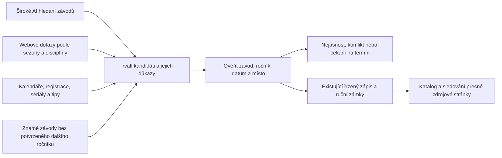

> Aktuální automatický provoz a bezpečné spouštění: [keep-fresh.md](keep-fresh.md). Následující piloty a příkazy jsou pomocné nástroje, nikoli další automatické sběrače.

# P1 · Nezávislé hledání závodů pro další sezonu

Datum: 24. 10. 2026. Stav: **první lokální verze implementována, pilot proběhl; rozšíření a produkční provoz čekají na výsledky kontroly**. Zadání od Radka: široký dotaz v ChatGPT našel závody pro rok 2027, které současné mechanismy nezachytily; navrhnout paralelní systém. Níže je původní plán; skutečný rozsah první verze popisuje následující provozní část. Ticket v Linearu nevznikl, připojení vyžadovalo znovupřihlášení.

## Implementovaná první verze

`scripts/discover-races.ts` a `src/lib/discovery/` přidávají nezávislé AI hledání, osm širokých dotazů přes Brave, trvalou lokální frontu s atomickými zápisy a lease, nejvýše tři souběžné pracovníky, sdílené původní modelové limity, snapshoty zdrojů, opakovatelnou diagnostiku CSV a porovnání s katalogem včetně skrytých/sloučených řádků. Hledání nečte CSV ani známé závody. Srovnání s CSV probíhá až následně; zdrojový benchmark má vlastní větev. Neúplná čtení zůstávají k opakování. Změna verze čtečky obnoví čtení uložených zdrojů, nikoli placené hledání. Vyhledávání se opakuje pro nový den/cyklus; dříve dokončené zdroje lze po 24 hodinách znovu přečíst, pokud je nový nález znovu přinese.

AI čtení běží i nad známými adaptéry. Kontrola roku nyní přijímá konkrétní blízký sezonní nadpis a kontrola názvu umí vazbu mezi označeným polem závodu a samostatným polem termínu. Titulek samostatného závodu se předává modelu doslova a patří do klíče cache. Název „Propozice“ již není závodem. Pravidla mají pozitivní i negativní regresní testy. Původní explorer zachovává parametry článků a ukládá také kandidáty přesahující limit čtení.

Lokální fronta je výzkumný outbox a pracovní stav, ne druhá produkční fronta URL ani serverless databáze. `--queue-leads` předá pouze zdroje slepě nalezených kandidátů s řádkovým důkazem do existující `discovered_links` jako `pending`. Nepřepisuje existující zamítnutí/pozastavení, neaktivuje watcher a nezapisuje závody. Schválení zdroje a publikace závodu zůstávají oddělené. Automatické ověření autority, místa, identity a publikace všech kandidátů zatím hotové nejsou.

### Spuštění a navázání

```sh
# Nezávislé hledání a omezené čtení; uložená práce se při opakování použije.
npm run discovery -- --season=2027 --mode=all --max=12 --minutes=5 --catalog

# Pokračovat pouze ve čtení již nalezených zdrojů.
npm run discovery -- --season=2027 --mode=read --max=20 --minutes=5 --catalog

# Diagnostika CSV; nejdřív bez modelu, pro AI použít samostatný adresář.
npm run discovery -- --mode=benchmark --max=38 --no-ai --out=tmp/discovery/benchmark-parser --catalog
npm run discovery -- --mode=benchmark --max=38 --out=tmp/discovery/benchmark-ai --catalog

# Pouze report bez nového hledání/čtení; předat --out pro konkrétní pilot.
npm run discovery -- --mode=report --catalog

# Volitelné předání podložených zdrojových URL do existující review fronty.
npm run discovery -- --mode=report --queue-leads
```

`queue.json`, `report.json`, `documents/` a `searches/` jsou v adresáři `--out`, standardně `tmp/discovery/CZ-2027`. Stav fronty se nesmí sdílet mezi různými počítači přes síťový disk; souběh je určen pro lokální procesy. Po změně čtečky se závěry znovu vyhodnotí; původní snapshoty a historie zůstanou. Časový limit zastaví převzetí dalších úloh, probíhající požadavek může doběhnout. Exit 2 znamená nedokončenou frontu, nikoli ztrátu výsledků. Úspěšné hledání bez výsledků je odlišné od retry po chybě API.

Výchozí modelový strop procesu je $0.25; sdílené stropy a ledger jsou stejné jako v `refresh-data.sh` ($0.50/den, $5/měsíc, pokud prostředí neurčí jiné). Brave má samostatný limit počtu dotazů; jeho účtování není zahrnuto v modelových nákladech. Klíče se načtou z prostředí nebo `.env.local`; chybějící poskytovatel zůstane ve stavu retry.

Samostatné discovery se spouští ručně uvedenými příkazy. Automatický místní sběr používá jednou denně bezplatné hledání `explore-sources.ts`; `DISCOVERY_SEASON` již v pravidelném běhu nespouští další placenou větev. Pro aktuální nasazení a plány viz `docs/keep-fresh.md`.

Pilot a jeho omezení: `reports/parallel-discovery-2026-10-24/REPORT.md`.

### Pokračování kontroly 24. 10.

Aktuálnější audit všech 51 položek, obrazový důkaz Malevilu, rozlišení počátku/konce rozsahů a stav OpenAI srovnání jsou v `reports/parallel-discovery-2026-10-24/continuation/REPORT.md`.

Volitelná větev OpenAI používá `gpt-6.1-sol` přes Responses API s `web_search`. Dostává stejné zadání jako Sonnet, vyžaduje použití hledání a ponechává jen adresy ze skutečně vrácených zdrojů. Její živý pilot zatím neproběhl: v místní konfiguraci chybí `OPENAI_API_KEY`. API klíč se nastavuje jen do prostředí nebo `.env.local`, nikoli do chatu nebo verzovaného souboru.

```sh
# Spustit samostatnou větev pro srovnání; nezvyšuje sdílený denní limit.
npm run discovery -- --providers=openai --mode=search --max=1 --out=tmp/discovery-comparison-2026-10-24/openai

# Cíleně ověřit tvrzení CSV, včetně dostupného lokálního renderování.
node scripts/with-node.cjs ./node_modules/tsx/dist/cli.mjs scripts/audit-discovery-benchmark.ts --render

# Přepočítat ověření uložených modelových tvrzení bez opakování modelu.
node scripts/with-node.cjs ./node_modules/tsx/dist/cli.mjs scripts/audit-discovery-benchmark.ts --sources=tmp/discovery-audit-2026-10-24/final/documents --recheck=tmp/discovery-audit-2026-10-24/final/report.json --out=tmp/discovery-audit-2026-10-24/rechecked
```

Přepínač `--providers` přijímá `ai` (Anthropic), `brave`, `openai`; výchozí zůstává `ai,brave`. Pro férové oddělené běhy používat samostatné adresáře. Cílený audit dostává vstupní názvy a údaje z CSV, proto není důkazem úspěšnosti nezávislého hledání. Stavy měsíce, předběžného termínu, chybějícího důkazu a konfliktu identity se nesmějí slučovat do jedné chyby nebo do potvrzeného závodu.

## Výsledek, který chceme

Vedle sledování známých zdrojů pravidelně hledat dosud neznámé závody tak, jak je hledá člověk s webovým AI vyhledáváním. Objevování nesmí záviset na tom, že už známe závod, jeho datum, pořadatele nebo správný parser. Zároveň nesmí široké hledání vypouštět do veřejného katalogu odhadnuté termíny.

První rozsah: ČR, sezona 2027. Produkční nasazení ani veřejné zápisy první verze neprovádí. Navazuje na `pipeline-improvement-proposal.md`, zejména discovery pilot; je konkrétním rozšířením jeho bodu 3. Dosavadní obecný audit a refaktor nejsou podmínkou spuštění malého samostatného pilotu.

## Co je doložené a co ještě ne

Přiložený `cyklisticke_zavody_cr_2027.csv` obsahuje **51 řádků a 38 různých URL**. Pět řádků má hvězdičku; tři z nich mají jen měsíc. To jsou kandidáti k ověření, ne 51 potvrzených samostatných závodů. Význam hvězdičky není v souboru vysvětlen, proto ji uchovat jako upozornění na nejistotu.

Uživatel uvádí přibližně 20 dříve chybějících závodů. Počet nebyl v tomto návrhu ověřen proti databázi. Lokální `scripts/seed-czech-2027-from-csv.ts` již obsahuje 18 ručně zapsaných položek; počet položek ve skriptu neprokazuje počet nových produkčních závodů. Existuje i následný skript pro odložení předběžného BSK Giro. Návrh neposuzuje aktuální produkční stav ani nepotvrzuje správnost všech údajů CSV.

Vstupní CSV je zachováno v `docs/fixtures/cyklisticke_zavody_cr_2027.csv`; SHA-256 původních bajtů: `f05f89eff2ec14ddead5cd46d074b5b42e6062349dd3b7f3107ef90d9e22850c`.

### Konkrétní omezení současného kódu

| Místo | Zjištění z pracovního stromu | Důsledek |
| --- | --- | --- |
| `catalog/web-research.ts`, `researchRaces` | Vstupem jsou existující veřejné aktivní řádky `events`; hledá web, přihlášky a propozice. Běžný výběr sahá rok dopředu. | Není to hledání nových závodů ani neznámých termínů. Pozdější část příští sezony může být mimo okno. |
| `watcher/explore.ts`, country packs | České dotazy převažují MTB/XC/gravel/dětský MTB. Výběr rotuje země i dotazy; další sezonu již podporuje. | Rok 2027 nechybí úplně, ale pokrytí disciplín a zdrojů je úzké. |
| `explore.ts`, `searchWeb` | Čte HTML DuckDuckGo, Bing spustí jen při prázdném výsledku. Chyby se mění na prázdný seznam. | Není to nezávislé spojení výsledků. Blokace/změna HTML může vypadat jako „nic nenalezeno“. |
| `looksLikeIndependentRaceUrl`, `queueDiscoveredLink` | Vyřazuje agregátory, UCI, sociální sítě, některé federace; URL musí navíc odpovídat slovům v doméně/cestě a evropským TLD. Ani `force` neobchází všechny zákazy. | Vyřazuje užitečné vstupní tipy ještě před přečtením. `uci.org`, `juniorcup.net`, klubový `tjsokolchotebuz.cz/index.php?...` nebo `svckostelec.cz/organizace-skolniho-roku` jsou příklady z CSV s takovými překážkami. |
| `canonicalExploreUrl` | Pro `/index.php` i některé jazykové/home cesty nastaví `/` a smaže query. | U Joomla odkazu na Chotěbuzský kopec ztratí `id=17` a další identitu článku; musí zachovat parametry určující obsah. |
| `runExplore` | Má časový limit, bere jen prvních `maxFetch` kandidátů; cron předává 20, admin 12. Zbytek nalezených URL není tímto během trvale odložen. | Nalezený výsledek se nemusí dostat ani do trvalé fronty. |
| `watcher/core.ts`, `extractors/llm-calendar.ts` | AI čtení neznámých stránek a kontrola důkazů už existují; kontrolují mimo jiné jméno, datum a ročník v citacích. | Nevytvářet další univerzální čtečku. Změřit její odmítnutí na konkrétních stránkách a rozšířit kontext důkazů tam, kde oprávněný údaj nezvládne. |

To jsou zjištění o chování kódu. Bez reprodukce jednotlivého běhu nelze každé položce CSV přiřadit právě jednu příčinu ztráty. Jeden uživatelský prompt také neříká, kolik interních hledání provedl ChatGPT; rozhodující je výsledek, cena a čas.

## Návrh: více nezávislých vstupů, společné ověření



„Paralelní“ má dva významy: nezávislé strategie hledají vlastní výsledky a jejich úlohy mohou běžet souběžně. Nestačí zrychlit současnou sadu úzkých dotazů. Stávající watcher dál hlídá změny známých zdrojů.

### A. Široký výzkum s webovým AI hledáním

Zadat stejný typ úkolu, který přinesl uživateli výsledky: „Najdi cyklistické závody v ČR v roce 2027. Vrať název, datum či jeho nejistotu, místo, disciplínu a skutečný zdrojový odkaz. Zahrň silnici, MTB, gravel, cyklokros, ultra a dětské závody. Neodhaduj termíny.“

Tato větev dostane sezonu a zemi, nikoli seznam známých závodů. Musí umět otevřít nalezené stránky a pokračovat přes seriál nebo pořadatele. Výstupem jsou strukturovaní kandidáti s citacemi a historií hledání, ne rovnou řádky `events`. U nalezené URL musí být dohledatelné, odkud pochází. Text webů, dokumentů a importů je nedůvěryhodný obsah, nikdy instrukce pro model.

### B. Systematické hledání mimo jeden široký prompt

Samostatné úlohy podle `země × sezona × disciplína × typ dotazu`; po základním pokrytí přidávat kraje a měsíce podle mezer. Hledat i výrazy jako „termín“, „kalendář“, „registrace“, „dětské závody“, „bikepacking“, „časovka“, „pohár“. Udržovat pokrytí 2027 až do prosince, ne pouze příštích 365 dní.

V pilotu porovnat webové AI hledání se samostatnou větví vyhledávacího API dostupného v projektu. Chyba poskytovatele, vyčerpaný limit, blokace a skutečně prázdná odpověď musí mít různé výsledky. Rozšíření na dalšího poskytovatele až podle čistého přírůstku; nepředpokládat, že dva modely nad stejným indexem znamenají dva nezávislé zdroje.

### C. Kalendáře a jiné rozcestníky jako vstupní tipy

Agregátor, federace, registrace, časomíra, obecní/klubová stránka i veřejný sociální příspěvek mohou dodat kandidáta. Nesmí být zamítnuty jen proto, že nejsou samostatným webem závodu. Autorita konkrétního údaje se řeší při ověření. Federace/UCI může být autoritativním důkazem termínu; nemusí se stát „vlastním webem pořadatele“.

Soukromý obsah a osobní údaje nepřenášet do veřejného katalogu. Automatické přijetí zdroje, přečtení závodu a zveřejnění závodu jsou různé kroky. Hledání nesmí rozhodnutím o vhodnosti webu zahodit nalezený termín.

### D. Dohledávání dalšího ročníku

Známé závody bez potvrzeného ročníku 2027 dostanou samostatnou frontu dotazů na název a sezonu. Předchozí ročník je vodítko k hledání, nikoli důkaz nového data. Sezonní datum se nesmí extrapolovat podle víkendu minulého roku.

## Fronta a souběh

Použít existující `discovered_links` pro zdrojové URL. Doplnit k ní trvalé úlohy hledání a kandidáty konkrétních ročníků, protože jedna URL může dokládat více závodů a jeden závod může mít více URL. Nezakládat druhou nezávislou frontu totožných URL. Název tabulek určit při implementaci podle aktuálního schématu.

- Úloha hledání: strategie, poskytovatel, dotaz, země, explicitní sezona, disciplína, verze, stav, čas, počet pokusů, lease a náklady.
- Kandidát: původní název a datumový text, možné datum/rozsah, přesnost a předběžnost data, místo, disciplína, URL, citace, identita řádku/sekce, vazby na všechny nálezy a případný existující závod.
- Důkaz: skutečná URL po přesměrování, čas a otisk stažení, uložený text/snímek, citace a lokální kontext ročníku, verze čtečky a důvody odmítnutí.
- Rozlišit stavy `found`, `verifying`, `verified`, `matched_existing`, `applied`, `waiting_for_date`, `conflict`, `retry`, `rejected`. Úspěšný kandidát se nepovažuje za zapsaný, dokud neuspěje zápis a ověření výsledku. Technická chyba nebo rozpočtový odklad nejsou zamítnutí.
- Nové nalezené odkazy uložit před omezeným čtením; limit pouze odloží zbytek. HTTP nedostupnost ponechá retry s důvodem a termínem.
- Pro pilot navržené nejvýše tři souběžné úlohy, jeden požadavek na hostitele; konečná čísla nastavit podle limitů. Lease s expirací a atomické převzetí zabrání dvojímu zpracování. Opakovaný běh a pád po zápisu nesmí vytvořit druhý závod.
- Zachovat ruční zamítnutí a pozastavení zdrojů; nový důkaz lze připojit bez jejich automatického odemknutí. Obsahové parametry URL uchovat, sledovací parametry odstranit. Deduplikace URL nesmí slučovat různé ročníky nebo kola.
- Sdílená cache dokumentů a rozpočtové rezervace musí fungovat přes všechny souběžné procesy. Současný lokální ledger sám o sobě není důkazem globálního limitu pro více workerů. Rozpočet rozdělit mezi hledání a ověření, aby nálezy nezůstaly bez kapacity k ověření.

## Čtení termínů: nevracet se k ručním seedům

Pro konkrétní kandidát cíleně otevřít nalezenou stránku, příslušný článek, kalendář pořadatele, přihlášku a propozice; využít existující HTML/PDF čtečky a dostupné renderování. Cache jednoho dokumentu slouží všem jeho závodům. Když dostupný runtime neumí stránku přečíst, uložit tuto příčinu a směrovat úlohu do schopného runtime; nevykazovat prázdný úspěch.

Datum může být v řádku a ročník v nadpisu jiné sekce. Uložit oba doslovné úryvky a jejich strukturální vztah ke stejnému závodu. Samotné „2027“ ve footeru, jiném článku nebo kalendáři nestačí. Nesprávně přísné odmítnutí opravovat konkrétním regresním příkladem, nikoli zrušením kontroly ročníku.

„Duben“, „Srpen“, „Září“, hvězdička a „připravuje se“ nesmějí být převedeny na potvrzený konkrétní den. Například „Září*“ v CSV nedokládá 24. září; přesné datum může dodat až jiný ověřený zdroj. Zachovat nejistotu, termín další kontroly a alternativní tvrzení. Samostatně ověřovat konec vícedenní akce a místo konkrétního ročníku.

Při párování prohledat veřejné, skryté i sloučené záznamy. Rozdílné datum může být chyba starého záznamu, takže hledání duplicity nesmí vyžadovat přesně stejné datum. Společná URL zase není identita závodu: Bike Paradise má v CSV pět položek na jedné stránce, Pražský MTB pohár pět položek na jednom článku. Rozhodnutí o tratích, etapách a samostatných závodech musí respektovat existující model katalogu. Konflikty a ruční zámky řeší existující řízená cesta zápisu; žádný nový přímý CSV/AI insert.

## Pilot a měření

1. **Výchozí stav:** zachytit verze kódu, konfiguraci, účinné limity a katalog před pilotem. U CSV klasifikovat všech 51 řádků: potvrzený závod/ročník, předběžný termín, nepřesnost, více tratí, duplicita nebo neověřeno. Ke každému uložit důkaz a stav v katalogu. Původní počet chybějících rekonstruovat jen z dostupného snapshotu před seedem; jinak ho označit za nezjištěný.
2. **Čtení odděleně:** všech 38 známých URL podat čtečkám v režimu bez zápisů. U každého řádku doložit, zda datum přečetl parser, AI, další dokument, nebo proč ho odmítly. Tím měříme čtení, nikoli schopnost závod samostatně najít. Současná stránka se mohla od včerejška změnit; uložený snapshot je nutný pro opakovatelnost.
3. **Slepé hledání:** větvím A/B zadat pouze ČR a sezonu 2027. Nedat jim CSV, jeho URL ani seznam závodů. Porovnat výsledky stejného časového okna a se známou cenou; katalog používat až k následnému párování. Vyhodnocovací replay oddělit od provozní filtrace již známých URL. Doplňující hledání konkrétních jmen vykázat zvlášť.
4. **Srovnání:** spočítat unikátní ověřené závody každé větve, překryv, přírůstek nad současné hledání, správně přečtené termíny, ztráty po jednotlivých krocích, falešné kandidáty, cenu a minuty kontroly na ověřený nový závod. Upsert, URL ani modelový návrh nejsou nový závod. Coverage CSV je podíl v ověřené části kontrolního seznamu, nikoli pokrytí všech závodů v ČR.
5. **Kontrola zobecnitelnosti:** další nezávisle připravená sada závodů nesmí sloužit k ladění dotazů ani parserů. CSV je diagnostická a regresní sada, protože už z něj vznikly opravy; samo neprokáže obecné zlepšení.
6. **Provozní přijetí:** po výsledcích pilotu zapojit opakované běhy, automatické převzetí ověřených bezkonfliktních kandidátů a další země. Na člověka směrovat nejasnosti, ne každý správně doložený závod.

### Podmínky dokončení prvního úkolu

- Každá položka CSV má doložený výsledek a důvod; žádný kandidát nezmizí kvůli limitu, pádu nebo vyčerpání rozpočtu.
- Regrese pokrývají klubový Joomla článek s query, `.net` doménu, federaci/UCI, sdílenou URL více závodů, kalendář s nadpisem ročníku, neúplné/předběžné datum a shodu se skrytým či zamčeným řádkem.
- Pilot prokáže alespoň jeden nový nezávisle objevený a ověřený závod nad výstup současného hledání ve stejném okně, nebo transparentně doloží nulový přírůstek. Bez čistého přírůstku nezapínat větší provoz.
- Pro ověřené přesné termíny v kontrolní sadě navržený cíl alespoň 90 % správně vyčtených dat; uvést čitatele, jmenovatele a všechny zbývající chyby. Žádný předběžný termín nesmí být povýšen na potvrzený den. Jde o cíl, ne dosažený výsledek.
- Restart a souběh nezdvojují závody, výpadek vyhledávání není „nula závodů“, review respektuje důkazy a ruční zámky. Náklady zahrnují hledání i ověřování a nepřekračují účinný sdílený limit.

## Pořadí práce ve frontě

| Pořadí | Úkol | Samostatně kontrolovatelný výstup |
| --- | --- | --- |
| 1 · P1 | Diagnostika CSV a oprava ztráty URL/kandidátů | Report 51 položek, uchování query a neodečtených nálezů, konkrétní regrese |
| 2 · P1 | Široké webové AI hledání + nezávislá vyhledávací větev | Slepý pilot ČR 2027, společný formát kandidátů, bez zápisů závodů |
| 3 · P1 | Ověřování termínů a napojení trvalých úloh | Opravené konkrétní chyby čtení, lease/retry, evidence, napojení existujících zámků a zápisů |
| 4 · Po pilotu | Opakované hledání a rozšíření zemí/sezon | Report čistého přínosu, cena, věk fronty, provozní harmonogram |

První automatické běhy navrhnout podle výsledků a kapacity fronty: široké hledání například týdně, cílené dohledání nově oznámených ročníků častěji. Tento návrh nezakládá automatizaci, nezvyšuje limity a nespouští placené API. Současné dokumenty obsahují rozdílné rozpočty; před pilotem zjistit skutečný účinný limit a použít ho beze změny. O stavu informovat při nových ověřených závodech, zásadních chybách nebo potřebě rozhodnutí.

### Kontrola kandidátů po hledání

Při `--catalog` nyní report obsahuje `candidateReview` pro každé vytěžené tvrzení. Rozlišuje doložené datum, možné shody i konflikty se staršími/skrytými/sloučenými záznamy a zvlášť podobnost zdrojové domény. Žádná kategorie nepovoluje automatický zápis nebo merge. Konkrétní ověřené předání tří pořadatelských URL do pending fronty je zaznamenáno v `reports/parallel-discovery-2026-10-24/continuation/SOURCE-REVIEW.md`.

### Nové zadání po pilotu

OpenAI a Sonnet sdílejí úplné zadání v `src/lib/discovery/prompt.ts`. Zahrnuje BMX, regionální kola, vyloučení jiných sportů a nezávodních akcí a výslovně oznámený ročník i při neznámém datu. Samotné datum v kontextu závodu je dostatečný podklad; plná věta se nevyžaduje. JSON výstup uchovává také kraj, seriál, children a status. `groundedHints` přijímá nové source_url/city i starší url/place, takže historické fronty zůstávají čitelné. Stav confirmed je názor vyhledávacího modelu, nikoliv souhlas s publikací; následná kontrola zdroje zůstává zachovaná. Přesné duplicitní návrhy se odstraní, různá kola zůstanou oddělená.

Čitelná verze: `reports/parallel-discovery-2026-10-24/NEW-PROMPT.md`. Nový text mění identitu vyhledávací úlohy, a proto jej příští spuštění nezamění za dokončený starý dotaz. Při této úpravě se další placené hledání nespouštělo a staré výsledky se nepřepisovaly.
