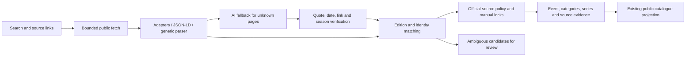

# Race data pipeline, October 2026

Status: implemented locally on `codex/pipeline-evidence-refactor`. Production
migration, refresh, merges and deployment have **not** been run. This document
describes the shipped changes and their practical limits, rather than a replacement
of all existing readers.

## Audit and priorities

The production baseline and comparison evidence are in
`reports/pipeline-refactor-2026-10-23/`. The initial suite passed 1,072 tests in 153
files. The catalogue snapshot had 8,853 total rows, 5,966 public unmerged rows and
1,141 public editions whose date range had not ended. Seven-day ingestion totals
were 1,068 runs, 19,459 upserts and 903 discovered links. Upserts are not new races.

Confirmed problems and the implemented response:

| Problem | Response |
| --- | --- |
| A shared URL joined different years or rounds; fingerprints bypassed country/format conflicts. | Hard identity checks run before URL/fingerprint confidence. Reassigned source ids are checked too. |
| Discovery blacklisted an entire known domain, and unpaged known-source queries lost rows. | Exact canonical URLs are deduplicated, preserving paused/rejected sources while allowing other race pages on that domain; queries are paged and errors surfaced. |
| A generic parser finding two rows prevented AI from finding the rest. | Unknown pages can use AI regardless of generic row count. Reliable adapters and JSON-LD retain precedence. |
| An AI result replaced a larger deterministic result; richer aliases inflated the count. | Same-snapshot results are combined. Matching dates and literal row evidence preserve the original identity and fill gaps. |
| Long calendars and budget failures lost partial results or marked a partial read complete. | Verified chunks survive failures; subsequent runs reuse cached prefixes and continue beyond the request limit. |
| A partial read or a capped write could checkpoint the page and hide omitted races. | Incomplete work clears HTTP checkpoints, is retried, and cannot hide races. AI omissions never establish removal. |
| An unchanged page prevented new extraction code from running. | HTTP content checkpoints include the reader version and are only reused by that version. |
| Generic headings and truncated news teasers became race names. | These specific invalid identities are rejected before generic ingestion. |
| AI duplicate judgement accepted identical titles without reading source pages, or stored permanent negative judgements from model confidence. | Source-page evidence is required; model-only negatives are not saved as durable reviews. Existing explicit reviews remain respected. |
| Failed DB writes/merges could look successful. | Identity lookups and main event writes fail visibly; per-event write errors are isolated, counted and retried. |
| The latest merge function omitted secondary series memberships and source facts. | The migration preserves both and adds transactional recovery snapshots. |
| Weak sources could overwrite official identity/date fields. | Aggregators may fill empty fields but cannot replace populated official identity/date/location/classification fields. Alternative assertions remain in source evidence. |

## Responsibilities



* Discovery remains the existing multilingual search/country rotation in
  `watcher/explore.ts`. AI additionally selects useful race/calendar/document
  anchors from fetched pages. It cannot invent URLs. A link is a lead, not a
  verified new race.
* `watcher/http.ts` handles host gating, retries, public-URL checks, charset
  decoding, conditional requests and an 8 MiB streamed body limit. PDFs with text
  are normalized into escaped text for the same readers. Scanned PDFs report an
  unsupported read instead of a successful empty calendar.
* `watcher/core.ts` preserves specialized adapters and JSON-LD. Unknown pages use
  the generic parser plus AI when credentials are present and `LLM_CALENDARS` is
  not `0`. Thin JavaScript pages can be rendered with the existing local Chrome
  reader. A deployment without that renderer reports the limitation.
* `watcher/extractors/llm-calendar.ts` verifies the full date, literal race name,
  explicit season, field quotes and actual row link. Series-heading evidence is
  separate from the row name, so a venue-only row can inherit a verified cup
  name. Country codes require literal support. Cancellation is accepted only
  with explicit cancellation wording in the verified row.
* `dedup.ts` assesses `match`, `review` or `distinct`. A model's confidence is
  not identity evidence. Tied best matches are deferred. Cross-year events with
  overlapping spans still match; separate editions do not.
* `watcher/run.ts` retains the existing country gates, manual locks, hidden-row
  handling, registration validation, category evidence and M:N memberships. It
  stores source assertions before those details can be lost behind a single
  display value. Changed stored fields also get `watcher_update_v2` fact records.
* Public rendering continues to use the existing event/location/category/series
  model and catalogue cache. There is no new public write endpoint or invented
  race/detail content.

## Caching, budgets and diagnostics

`llm/extraction-cache.ts` keys raw assertions by the complete request: model,
prompt/version, URL and source chunk. All cache hits are verified again, including
against today's date. Cache age is seven days. Process memory is bounded to 64
entries; identical in-flight requests share work.

Local refreshes set `LLM_EXTRACTION_CACHE_DIR=tmp/extraction-cache`. On Vercel the
default backend is the new service-role-only `pipeline_extraction_cache` table;
`LLM_EXTRACTION_CACHE_BACKEND=supabase` also selects it explicitly. Expired database
entries are pruned. The migration must exist before deploying this backend.

Existing Anthropic token accounting and request reservation remain in use.
Calendar and process budgets still apply; a local shared ledger spans refresh
steps. These are **not a new global monthly serverless billing cap**. Cost is an
estimate using the repository's model price table.

`ingest_runs.metrics` records extracted/attempted/upserted/created/updated/rejected/
failed counts, completeness, issues, AI usage and chunk/cache diagnostics.
`updated` counts completed update operations, not distinct semantic changes.
Facts supply the field-change evidence. Structured logs use the same metrics.
HTTP success, a parsed row and a new public upcoming race remain different measures.

## Safe comparison

```sh
# No database writes; --catalog only reads catalogue/source representation.
node scripts/with-node.cjs tsx scripts/audit-pipeline.ts \
  --url=https://www.dsergebnis.de/ --ai --catalog --follow \
  --max-pages=6 --out=tmp/pipeline-audit

# Reuse archived documents and frozen baseline parser results.
node scripts/with-node.cjs tsx scripts/audit-pipeline.ts \
  --replay=tmp/pipeline-audit --ai --catalog --out=tmp/pipeline-replay

# Reconstructed regression fixtures; no network/model/database calls.
node scripts/with-node.cjs tsx scripts/benchmark-identity.ts
```

The audit script keeps original HTML, deterministic extraction and fetch time in
its source archive. A replay runs current verification/combination logic against
those inputs. It reuses the captured deterministic result rather than rerunning
adapters that might fetch other pages. Candidate representation checks do not
prove novelty: weak names, missing places and hidden records require review.

## Transactional merge recovery

`20261023191651_audited_event_merges.sql` adds the cache and run metrics, and wraps
the existing merge implementation. Both event records, redirects, sources,
categories, favorites, attendance, series, facts and lock state are captured
before and after a merge. History and cache have RLS and service-role-only grants.
The old implementation is moved out of the exposed schema.

The wrapper preserves the current field-selection/lock behavior and moves all
secondary memberships and facts. A failed history insert rolls back the entire
merge. A pair already reviewed as separate cannot be merged. Repeating the same
merge is idempotent.

Restore compares current state to the saved after-state. Any covered subsequent
edit or personal-plan change causes refusal; manual reconciliation is then
required. Restore retains original event ids and skips generated event columns.
It is available only for merges performed after this migration, not older merges.

```sh
# Isolated PostgreSQL test; installs its test-only engine outside project dependencies.
npm install --prefix tmp/pipeline-db-test --no-package-lock --no-save @electric-sql/pglite
node scripts/test-merge-recovery.mjs

# Inspect first. This prints ids/status, not private plan snapshots.
node scripts/with-node.cjs tsx scripts/restore-event-merge.ts --history=<uuid>
# Explicit execution after reviewing the recovery point:
node scripts/with-node.cjs tsx scripts/restore-event-merge.ts --history=<uuid> --apply
```

The PostgreSQL test exercises the actual merge migrations against a reduced
isolated schema, including the primary-series trigger, generated columns,
personal-plan reconciliation, exact restoration, stale-state refusal, role
permissions, idempotency, separate-pair refusal and transaction rollback. This
does not replace a staging check against the complete production schema.

## Rollout and remaining limits

1. Review the local diff and evidence report. Do not infer catalogue-wide
   precision/recall from the small regression/source sample.
2. After approval, apply the additive migration before deploying the new watcher.
   Validate its grants, a private cache read/write, metrics and merge recovery on
   staging. Keep `LLM_CALENDARS=0` during any staged rollout that should not spend
   model credit.
3. Enable bounded AI fallback and poll a small source batch. Versioned checkpoints
   cause a reread on each source's next normal poll. Compare new-public-upcoming
   editions and verified field changes, costs, errors and review load.
4. Review merge proposals in dry mode before approving a production merge pass.
   Do not automatically unhide existing records discovered by another source.

No broad refresh, cleanup, migration or deployment was performed in this task.
Automatic AI augmentation of otherwise reliable adapters/JSON-LD is deliberately
not universal; the audit tool can evaluate those pages explicitly. A comprehensive
source-trust hierarchy, calibrated large labeled identity dataset, durable
per-candidate review workflow and transactional rollback of arbitrary field updates
remain follow-up work. The existing per-event writer is still multi-step; failures
are visible and retryable, but it is not a single database transaction. Local
Chrome and text extraction do not guarantee support for every dynamic or scanned
document. These limits should be assessed before unrestricted production expansion.
