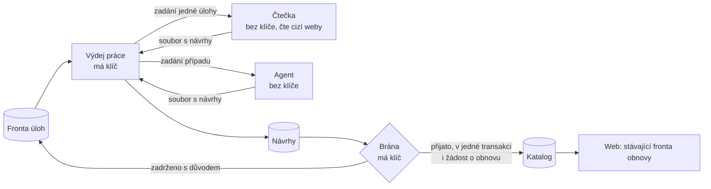

# Pipeline verze 2: návrh a plán stavby

Stav k 11. 11. 2026: návrh, nic z toho neběží. Druhé znění, po připomínkách Codexu z téhož dne; co se jimi změnilo, je na konci. Vychází z měření verze 1 a z odpovědí vlastníka: celý provoz do 10 USD měsíčně, Mac běží přes den i v noci (ale je to notebook), agent může být Claude i Codex, o komerčním využití zatím není rozhodnuto.

Navazuje na [systém doplňování závodů](race-completion-system.md), [pravidla ročníků](annual-editions.md) a [návrh agenta](race-agent.md). Ty zůstávají v platnosti. Tento dokument mění **jak se práce plánuje, doručuje a hlídá**, ne jak se čtou stránky.

## Co už je a co ne

Stav k 11. 11. 2026 večer. ✅ je a běží · 🔶 je zčásti · ⬜ není.

| Oblast | Co | Stav | Poznámka |
| --- | --- | --- | --- |
| **Pravdivý stav** | Krok řekne, jak skončil (hotovo, část, vypršel čas, zavřeno zvenčí, čeká na rozpočet, selhal) | ✅ | krok A, `stepOutcome` v `local-cycle.cjs` |
| | Průchod se selhaným krokem se nejmenuje hotový | ✅ | krok A |
| | Souhrn složený z uložených výsledků, s barvou | ✅ | krok A, `npm run pipeline:status` |
| | Zavřený web se nezkouší při každém průchodu | ✅ | krok A, čeká svůj obvyklý interval |
| **Odklady** | Odklad po selhání 1 h až 7 dní, zastavení po pátém, týdenní pokus | 🔶 | krok B, testy prošly a první průchod po instalaci v 17:06 SEČ měl 0 selhání kroků. Měření za 24 h čeká na 12. 11. večer. [Bod 1](../reports/pipeline-v2/krok-b/OVERENI-PROVOZU.md) |
| | Sdílený odklad pro tentýž web | 🔶 | krok B, test prošel. První provozní zkouška rad-netu čeká na průchod 12. 11. kolem 15:40 SEČ. [Bod 1](../reports/pipeline-v2/krok-b/OVERENI-PROVOZU.md) |
| | Vypršený čas během spánku Macu se nepočítá jako selhání | ✅ | krok B |
| | Ruční obnova kroku | ✅ | `npm run pipeline:status -- --retry=<krok>` |
| **Fronta** | Převzetí s pronájmem, dokončení jen platným pokusem, historie pokusů | ✅ | z verze 1, migrace od 2. 11. |
| | Čtení zdrojů přes frontu s kontrolou revize | ✅ | z verze 1 |
| | Hlášení pracovníků | ✅ | z verze 1, `pipeline_workers` |
| | Práce z cyklu na Macu jako úlohy (propozice, weby, místa…) | 🔶 | hledání propozic na webech závodů běží přes frontu ostře od 11. 11.; ostatní kroky ještě ne |
| | Důvod jako výčet u každého pokusu | 🔶 | na Macu ano (krok A), ve frontě ne |
| **Klíče** | Čtečky na Macu bez přístupu k produkci | ✅ | z verze 1, `local-run.sh` a `local-guard.cjs` |
| | Výdej práce: čtečka dostane jen zadání jedné úlohy | ✅ | pro hledání propozic; čtečka běží bez klíčů a se zábranou proti našemu serveru |
| **Návrhy a brána** | Historie zapsaných údajů s citací a vratností | ✅ | z verze 1, `event_facts` |
| | Kandidáti na nové závody s posouzením | ✅ | z verze 1, `pipeline_candidates` |
| | Tabulka návrhů a jedna brána | 🔶 | na produkci od 11. 11. pro odkaz na propozice; všechny cesty k tomuto poli jdou přes ni (fronta, čtečky na Macu, agent). Další pole ještě ne |
| | Mapa všech cest, které zapisují do katalogu | ✅ | [pipeline-write-paths.md](pipeline-write-paths.md) |
| | Kopie katalogu na Macu doplňovaná po změnách | 🔶 | přijaté odkazy na propozice se do kopie doplňují; jinak dál celý výpis |
| **Ročníky** | Pravidla a cesta pro nový ročník | ✅ | z verze 1, `decideEdition`; agent k ní dodává oznámené termíny (jen ze stránek, které kontrola pořadatelů čte) |
| | Přehrání zadržených „proběhl → plánovaný“ | ✅ | 97 případů: 95 byly proběhlé závody a jen zastaralá kopie na Macu. Kopie je teď uzavírá sama; zbyly 2 |
| **Zveřejnění** | Žádost o obnovu stránky oddělená od kontroly HTML | ✅ | z verze 1 |
| | Kontrola HTML podle druhu změny | ⬜ | dnes každá stránka, 60 denně |
| | Roztřídění čekajících kontrol stránek | 🔶 | 744: 647 běžných s podanou žádostí o obnovu, 41 bez žádosti, 32 skrytých, 24 sloučených. Nic neuzavřeno; změna kontroly vyžaduje úpravu webu |
| **Pracovníci** | Mac se správcem a panelem v liště | ✅ | z verze 1 |
| | Cloudový pracovník | 🔶 | `.github/workflows/pipeline.yml`: historie počasí, ruční spuštění; první běh 11. 11. prošel. Plán a odebrání z Vercelu ještě ne |
| **Agent** | Agent je Codex, pracuje přes přepážku (`scripts/agent-desk.cjs`) | ✅ | definice `.codex/agents/race-finder.toml`; strop 20 odpovědí denně; Claude v cyklu vypnutý |
| | Spouštění přímo z cyklu (Claude nebo jiný příkaz) | 🔶 | napsáno a vyzkoušeno na 5 případech, **vypnuto** (`AGENT_IN_CYCLE=1` ho zapne) |
| | Denní příprava případů, opakování nevyřešených po týdnu | ✅ | krok cyklu po 6 hodinách |
| | Ověření citací kódem | ✅ | `scripts/agent-verify.ts` |
| | Ověřené nálezy jdou bráně; ověřené „různé závody“ uvolní zadržený závod | ✅ | první nález agenta je v katalogu od 11. 11. |
| | Další druhy případů: vyjížďka nebo závod, termín dalšího ročníku, chybějící závody v kalendáři, duplicity uvnitř katalogu | 🔶 | napsáno, testy tvaru a ověření; první odpovědi Codexu na ně teprve přijdou |
| | Agent pro opravu čteček | 🔶 | `.codex/agents/reader-repair.toml`, seznam 238 zdrojů přes `agent-desk.cjs repairs`; neběžel |
| | Vyhodnocení správnosti na vzorku | 🔶 | Claude 5 případů bez chyby; Codex 20 odpovědí: 15 ověřených citací, 2 neověřené, 3 „nevím“. Ruční čtení vzorku Codexu ještě ne |
| **Přehled** | Panel v liště | ✅ | z verze 1; nový souhrn zatím nečte |
| | Okno se souhrnem na ploše | ⬜ | zkusil jsem 11. 11., vlastník ho odmítl a je odstraněné; souhrn zůstává v `npm run pipeline:status` |
| | Souhrn v administraci | ⬜ | vyžaduje změnu webu a nasazení |
| **Hosting** | Měření CPU po přesunu úloh z Vercelu | ⬜ | |
| | Zkouška Cloudflare | ⬜ | |

## Co verze 1 ukázala

| # | Problém | Měření (11. 11.) |
| --- | --- | --- |
| 1 | Cyklus na Macu je seznam kroků. Rozbitý krok se zkouší znovu při každém průchodu a nikdo ho nevypne. | `radNetNew` selhal 10. 11. 31× za den na webu, který je od 8. 11. trvale zavřený kontrolou robotů. `regulations` 11. 11. pětkrát narazil na časový limit. |
| 2 | Výsledek kroku neříká, co se stalo. | Průchod skončí `finished` s `failedUpkeep: radNetNew, radNet` uvnitř. Kód 2 znamená „odloženo“ i „vypršel čas“ (`bounded-pipeline-step.cjs`), takže krok, který se nikdy nevejde do limitu, vypadá jako rozpracovaný. |
| 3 | Dva katalogy (Mac a server) se srovnávají přes výpis, dočasnou databázi, rozdíl a odeslání. | 13 souborů `scripts/local-*`, asi 1 900 řádků, které jen převážejí data. Výpis katalogu 4,6 MB až 10× denně. |
| 4 | Ověření veřejných stránek nestíhá. | 742 čekajících kontrol HTML, nejstarší z 2. 11., strop 60 denně. **Obnova stránky sama se nezdržuje:** 724 z nich už má zapsanou žádost o obnovu, čeká jen drahá kontrola. |
| 5 | Sporné případy nikdo nerozhoduje. | 775 zadržených změn u 137 závodů. |
| 6 | Velká část zdrojů se nečte. | 1 927 z 2 681 zdrojů je pozastaveno. Je to úmyslné pozastavení, ne chyba fronty, ale nikdo se k nim nevrací. |
| 7 | AI přes API dojde v půlce dne i měsíce. | Listopad: 3,89 z 5 USD za 11 dní. Kroky s AI denně končí „waiting: AI allowance spent“. |
| 8 | Hosting je přes limit. | Vercel: 9,5 h CPU proti 4 h (měřeno 6. 11., účinek oprav zatím neznáme). Supabase: v říjnu 5,77 GB necachovaného přenosu proti 5 GB. Databáze 109 z 500 MB, tam problém není. |
| 9 | Rozsah. | 188 skriptů, 54 čteček, stav na čtyřech místech (soubory JSON, databáze na Macu, databáze na serveru, `reports/`). |
| 10 | Přehled ukazuje stav průchodu, ne výsledek. | Panel v liště existuje, ale neříká, kolik závodů přibylo, co stojí a proč. |

Co verze 1 udělala dobře a zůstává: čtečky a jejich testy, ověřování doslovnou citací, pravidla totožnosti a ročníků, zápisy v jedné transakci, vratná sloučení, historie údajů v `event_facts`, OCR na Macu, společný rozpočet AI, zásada, že čtečka nedostane přístup k produkci, a **trvalá fronta na serveru**, která už umí víc, než první znění tohoto návrhu přiznávalo (viz část 1).

## Verze 2 v pěti větách

1. **Úlohy místo kroků.** Práce z cyklu na Macu se převede na položky ve stávající frontě: jeden zdroj, jeden závod, jeden dokument. Každá má vlastní termín, pokusy a důvod posledního výsledku.
2. **Návrhy místo zápisů.** Čtečky do katalogu nezapisují. Odevzdávají návrh: závod, pole, hodnota, adresa, doslovná citace, čtečka a její verze. Do katalogu vede jediná brána.
3. **Pracovníci podle schopností.** Mac umí prohlížeč, OCR a agenta. Cloudový pracovník umí obyčejné čtení a údržbu a běží i se zavřeným notebookem.
4. **Agent je pracovník, ne správce.** Dostává zadržené a zastavené položky a vrací návrhy. Projdou stejnou branou a stejnými testy jako všechno ostatní.
5. **Jeden stav, odvozený z uložených výsledků.** Čte z něj panel v liště, widget i administrace.

## Části

### 1. Fronta: rozšířit, co už běží

Fronta existuje (`20261102084307_durable_publication_tasks.sql` a navazující migrace). Verze 2 ji nenahrazuje.

| Už je | Kde |
| --- | --- |
| převzetí s pronájmem a tokenem, dokončení a odklad jen platným tokenem | `pipeline_claim_tasks`, `pipeline_finish_task`, `pipeline_retry_task` |
| historie pokusů | `pipeline_task_attempts` |
| převzetí zdroje a transakční dokončení s kontrolou revize zdroje | `pipeline_claim_source_read`, `20261104075042_commit_source_read_atomically.sql` |
| stropy podle druhu (60 kontrol HTML denně a další) | uvnitř `pipeline_claim_tasks` |
| hlášení pracovníků | `pipeline_workers`, `/api/ops/pipeline-status` |

Co verze 2 skutečně přidává:

- **Nové druhy úloh** pro práci, která dnes žije jen v `local-cycle.cjs`: `site_details`, `find_documents`, `read_regulations`, `check_details`, `find_website`, `geocode`, `weather_history`, `agent_case`.
- **Důvod jako výčet** ve výsledku pokusu: `robot_check`, `sign_in`, `timeout`, `partial`, `shape_changed`, `empty_but_dated`, `http_error`, `no_document_yet`, `ai_budget`, `capability_missing`.
- **Odklad podle důvodu.** Do řady 1 h, 6 h, 1 den, 3 dny, 7 dní se počítají jen skutečná selhání (`timeout`, `http_error`, `shape_changed`, `empty_but_dated`). `ai_budget` čeká do obnovy rozpočtu, `no_document_yet` se vrací podle blízkosti závodu, `partial` pokračuje hned, `capability_missing` čeká na pracovníka, který ji má. Žádný z těch čtyř se nepočítá jako selhání.
- **Zastavení.** Po pátém selhání stav `stopped`. Jednou týdně se položka sama zkusí znovu; když uspěje, počitadlo se vynuluje. Mezitím jde jako případ agentovi. Stránka s kontrolou robotů se nečte nikdy a nijak; týdenní pokus jen zjistí, jestli kontrola zmizela.
- **Sdílený odklad pro tentýž web.** `radNet` a `radNetNew` čtou jeden zavřený web, takže odklad patří hostiteli, ne úloze.
- `queue.ts` je tenká vrstva nad stávajícími funkcemi: sestaví výčet důvodů, spočítá odklad a zavolá `pipeline_retry_task`. Vlastní převzetí ani pronájem nepíše.

**Zdroje mají vlastní pravidla a ta platí dál.** U `source_read` určuje termín `watched_urls.next_poll_at` a stav zdroje; trigger `pipeline_sync_source_task` podle nich úlohu přepisuje na `pending` nebo `blocked`. Odklad po selhání se proto u zdrojů zapisuje do `next_poll_at`, ne do úlohy, jinak by ho trigger při nejbližší změně zdroje smazal. Pořadí je: pozastavení zdroje, pak `next_poll_at`, pak cokoli jiného. Schopnost prohlížeče se dál jmenuje `browser`, jak je ve frontě; nové jsou jen `ocr` a `agent`.

**Co musí projít testem u prvního nového druhu úlohy** (v izolované databázi, jako `scripts/test-source-work.mjs`): dva pracovníci chtějí tutéž položku; pracovník spadne po zápisu návrhu a před dokončením úlohy; starý pracovník doběhne po vypršení pronájmu; vstup se změní během práce. Ve všech čtyřech smí výsledek zapsat jen platný pokus a žádný návrh nesmí vzniknout dvakrát.

### 2. Kdo má klíč

Dnešní funkce fronty smí volat jen `service_role`, takže čtečka bez klíče si práci sama vzít nemůže. Proto tři role:

| Role | Má klíč k produkci | Čte cizí weby | Co dělá |
| --- | --- | --- | --- |
| Výdej | ano | ne | Vezme úlohy, každou zapíše jako soubor se zadáním (adresa, co o závodě víme, uložený otisk). Po návratu ověří tvar výsledku, uloží návrhy a dokončí úlohu svým tokenem. |
| Čtečka, agent | ne | ano | Dostane jen soubor se zadáním. Vrátí soubor s návrhy a důvodem. |
| Brána | ano | ne | Rozhoduje o návrzích a zapisuje. |

- **Na Macu:** čtečka se spouští s výslovně sestaveným prostředím (cesta, jazyk, složka pro zadání a výstup, případně klíč k AI s limitem), ne s celým prostředím rodiče, jak to dnes dělá `bounded-pipeline-step.cjs`. Pracovní složka čtečky neobsahuje `.env.local`. Kopie katalogu, ze které čtečka srovnává totožnost, je jen ke čtení.
- **V cloudu:** tři oddělené joby, ne kroky jednoho jobu, protože kroky sdílejí pracovní adresář. Výdej a brána mají tajné klíče, čtečka ne. Mezi nimi se předává jen soubor (artifact) s pevným tvarem, který další job ověří dřív, než z něj cokoli použije. Stažený obsah cizích webů se do jobu s klíčem nedostane jinak než jako citace v tomto souboru.
- Výstup čtečky a agenta je vždy jen data. Nic z něj se nespouští a žádný text v něm nemění, co výdej nebo brána udělá.

### 3. Návrhy a brána

- **Návrhy mají vlastní tabulku** `pipeline_proposals` (klíč návrhu, závod nebo kandidát, pole, hodnota, adresa, citace, čtečka, verze, stav `proposed` / `applied` / `held` / `rejected` / `superseded`, důvod, čas rozhodnutí). `event_facts` zůstává historií toho, co se skutečně zapsalo, a jeho stavy (`active`, `rolled_back`, `superseded`, `rejected`) se nemění, takže se nemusí upravovat žádné čtení historie. Nový závod jde dál přes `pipeline_candidates`.
- **Klíč návrhu** je otisk (závod, pole, hodnota, adresa, verze čtečky). Stejný návrh doručený dvakrát je jeden řádek a jeden zápis.
- **Brána** je modul `src/lib/pipeline2/gate.ts` s testy a jedna databázová funkce pro zápis. Funkce v téže transakci znovu ověří ruční zámek, aktuální hodnotu pole a to, že závod není mezitím sloučený nebo skrytý. Teprve pak zapíše hodnotu, řádek do `event_facts` a stávající trigger založí úlohu obnovy webu. Pád po zápisu tak žádost o obnovu neztratí.
- **Mapa zapisujících cest** je první výstup fáze 2, ještě před kódem brány: sběr (`watcher/run.ts`), doplňování (`local-fills`, `enrich-practical-details`, `fill-*`), údržba katalogu (`/api/cron/catalog`), ruční opravy v administraci, úpravy pořadatele, `apply-reviewed-fixes.ts`, sloučení. U každé: jde přes bránu, nebo zůstává vedle a proč. Ruční opravy a úpravy pořadatele bránu obcházet smějí, ale musí nastavit zámek, který brána ctí.
- **Vratnost podle operace**, protože `pipeline_rollback_fact` pokrývá jen vybraná pole a má podmínky:

| Operace | Jak se vrací |
| --- | --- |
| doplnění nebo změna pole | `pipeline_rollback_fact`; pole, která neumí, brána do doplnění funkce nepřijímá automaticky |
| sada kategorií | obnova uložené předchozí sady (`20261104123049_restore_recorded_category_sets.sql`) |
| sloučení | `restore-event-merge.ts` z `pipeline_merge_history`, s jeho podmínkami |
| založení závodu nebo ročníku | skrytí s důvodem, ne smazání; kandidát se vrací do stavu k posouzení |

- **Kopie katalogu na Macu** slouží jen čtečkám k předběžnému srovnání; závazné ověření dělá brána proti produkci. Doplňuje se po změnách, ale ne prostým „novější než poslední stažení“. Testy musí pokrýt: víc řádků se stejným časem (stránkování podle času a klíče), přerušené stahování uprostřed stránky, smazané a sloučené záznamy, změnu souvisejícího záznamu bez změny závodu (místo, vazba na sérii, kategorie). Jednou denně se porovná počet a otisk klíčů po tabulkách; při neshodě nebo po výpadku delším než týden se kopie stáhne celá, jako dnes.

### 4. Ročníky: 89 případů se nejdřív přehraje

Přechod „proběhl → plánovaný“ může být nový ročník, chybná vazba na jiný závod, nebo oprava stavu. První znění z něj dělalo jedno pravidlo; to by zakládalo chybné ročníky.

- Nový ročník vznikne jen s výslovně oznámeným datem pro nový rok, potvrzenou totožností závodu a správným kolem série, stávající cestou `decideEdition` → `validateReviewSource` → `ingestReviewedCandidate`.
- Před založením se hledá i mezi skrytými a sloučenými záznamy.
- Starý ročník a jeho historie zůstávají; převzaté údaje nesou původ a `age_confidence = previous`.
- **Úkol před stanovením cíle:** přehrát uložených 89 případů a rozdělit je: založit nový ročník, přiřadit k existujícímu, opravit stav, dál čeká. Cíl pro počet zadržených se stanoví z tohoto rozdělení, ne předem.

### 5. Zveřejnění: navázat na to, co běží

Žádost o obnovu stránky a drahá kontrola HTML už jsou oddělené (`public_expire`, `pipeline_refresh_receipts`) a `/api/ops/publication` vyžaduje platný pronájem a revizi. Brána nevolá web sama; spoléhá na úlohu založenou v transakci zápisu.

Co se mění:

- **Kontrola HTML podle druhu změny.** Běžné doplnění pole: denní vzorek. Skrytí, sloučení, změna data, změna adresy stránky: kontrola konkrétních dotčených výstupů, tedy nová i stará adresa, jazykové verze, stránka série a katalog, kde se změna projeví.
- **742 čekajících kontrol se nejdřív roztřídí.** Dnešní stav: 724 má žádost o obnovu, z toho 705 pro aktuální revizi; 18 žádost nemá; 24 patří sloučeným závodům. Uzavřít lze jen běžná doplnění s potvrzenou žádostí pro aktuální revizi. Ostatní se dokončí. Administrativní uzavření se nepočítá mezi vyřešené případy.
- **Dvě měření místo jednoho:** čas od přijetí návrhu do žádosti o obnovu, a čas do ověřené změny na webu.
- **Cíl podle toho, kdo běží.** S běžícím Macem do hodiny po žádost o obnovu. Bez Macu podle plánu cloudu, viz níže; hodinu tam neslibuji.

### 6. Pracovníci a přesun z Vercelu

| Pracovník | Schopnosti | Kdy bere práci |
| --- | --- | --- |
| Mac | `http`, `browser`, `ocr`, `agent` | Kdykoli běží. |
| Cloud (GitHub Actions) | `http` | Podle plánu. Úlohy sdílené s Macem bere, jen když se Mac podle `pipeline_workers` neozval déle než 30 minut. |

GitHub spouští plánované běhy z výchozí větve (`main`) a může je zpozdit nebo vynechat. Při plánu po dvou hodinách je tedy rozumné počítat s převzetím do tří hodin, ne dřív.

Úlohy z `vercel.json` se přesouvají **po jedné**. U každé platí: právě jeden aktivní plánovač, test s vypnutým Macem, a návrat je vrácení řádku do `vercel.json`.

| Úloha | Co obsahuje | Na co si dát pozor |
| --- | --- | --- |
| `weather-history` | historie počasí | Nejjednodušší, jde první. |
| `catalog` | údržba katalogu bez čtení webů | Zapisuje do katalogu: zahrnout do mapy zapisujících cest. |
| `publication` | žádosti o obnovu, kontroly HTML, **i `completePlanChanges` a obnova souhrnného katalogu** | Volá web; kontroly HTML dál stojí CPU webu, ať je spouští kdokoli. |
| `alerts` (denně 5:45) | upozornění e-mailem | Zachovat čas. Doložit ochranu před dvojím odesláním při opakovaném i souběžném běhu a doběhnutí po vynechaném termínu. |
| `digest` (středa 4:00) | týdenní přehled | Totéž. Jde poslední. |

### 7. Agent

Rozšiřuje [návrh z 10. 11.](race-agent.md). Začíná v režimu návrhů: nic z jeho výstupu se nepoužije, dokud daný druh práce neprojde vlastním vzorkem.

| Druh případu | Výstup | Ručně ověřený vzorek měří |
| --- | --- | --- |
| `decide_held` | rozhodnutí s adresou a citací | shodu s rozhodnutím v session |
| `find_regulations` | jen odkaz na dokument | jestli dokument patří tomuto závodu a ročníku |
| `extract_document` | údaje s citacemi | správná, chybná a vynechaná pole proti očekávaným údajům |
| `find_races` | chybějící závody s adresou a citací data | kolik je opravdu nových, kolik duplicit, kolik chybí |
| `repair_reader` | větev s opravou a testem | očekávané výstupy na více uložených stránkách |

- **Každý druh se vyhodnocuje zvlášť.** Pilot jednoho druhu neříká nic o ostatních. U každého se měří správnost přijatých výsledků, vynechané údaje a čas na ověření. Citace musí patřit správnému závodu, ročníku i poli, ne jen stát na stránce.
- **Spouštění:** `scripts/agent-run.cjs` v roli čtečky podle části 2: dostane soubory se zadáním, zavolá nástroj z nastavení (`AGENT_CMD`, tedy `codex exec` nebo `claude -p`) s pevným seznamem povolených nástrojů a časovým limitem, a vrátí soubor s návrhy. Úspěch se pozná z ověřeného výstupu, ne z toho, že proces skončil.
- **`repair_reader`:** test jsou očekávané výstupy z několika uložených stránek, včetně prázdné, rozbité a nejednoznačné. Počet vrácených řádků kritériem není; chybné párování nebo duplicity ho umí zvýšit. Oprava zůstává ve větvi k posouzení v session. Automatické přijetí v tomto návrhu není.
- **Úspora API je zatím hypotéza.** Než se s ní začne počítat, ověřit na Macu skutečné přihlášení, účtování a limity konkrétní konfigurace Claude a Codexu pro noční běh bez obsluhy. `codex` teď na Macu jako příkaz není.
- **Co agent nedělá:** nezapisuje do katalogu, neodvozuje datum z loňska, nečte stránky s kontrolou robotů, nenasazuje web.

### 8. Místa a počasí

- **Místa:** úloha `geocode` na místo. Výsledek se ukládá ke klíči název místa, obec a země, takže stejný název ve dvou zemích nesplyne a stejný dotaz se neposílá dvakrát. Nejisté výsledky jdou jako případ agentovi.
- **Historie počasí:** úloha na místo a týden v roce. Přepočítá se, když se změní souřadnice místa o víc než kilometr, datum závodu, nebo zdroj dat; jinak se nemění.
- **Předpověď:** změřit, jestli ji může prohlížeč číst přímo z Open-Meteo. Snížilo by to CPU webu. Limity Open-Meteo a podmínka nekomerčního použití platí dál, jen by se počítaly na návštěvníka.

### 9. Přehled a widget

- **Souhrn se odvozuje, nezapisuje.** Funkce ho složí z `pipeline_tasks`, `pipeline_task_attempts`, `pipeline_proposals`, `pipeline_workers` a na Macu z `monitor.json` a `local-cycles/*/result.json`. Mac a cloud si tak nepřepisují jeden soubor. Server ho vydává přes stávající `/api/ops/pipeline-status`.
- Obsah: kdy se kdo naposledy ozval; za 24 hodin a 7 dní nové závody, doplněná pole, přijaté a zadržené návrhy; fronta podle druhu (čeká, zpožděno, zastaveno s nejčastějším důvodem); nejstarší čekající položka; útrata AI.
- **Barvy:** zelená, když se pracovníci hlásí a nic splatného nečeká déle, než má; platí i v den, kdy nebylo co dělat. Žlutá, když práce stojí z důvodu mimo nás (rozpočet, pořadatel nevydal, zavřený web). Červená, když se pracovník neozval, nebo přibývá zastavených položek.
- **Widget na ploše:** stávající aplikace `macos/LetsRaceMonitor` dostane okno bez rámu na úrovni plochy se stejným souhrnem. Staví se stejným `swiftc` jako dnes. Nativní widget přes WidgetKit vyžaduje plný Xcode, který na Macu není.

## Hosting a ceny

| Možnost | Cena měsíčně | CPU | Komerční použití |
| --- | --- | --- | --- |
| Vercel Hobby (dnes) | 0 | 4 h, pak se funkce zastaví | ne |
| Vercel Pro | 20 USD a spotřeba | podle spotřeby | ano |
| Cloudflare Workers Paid | 5 USD | 30 mil. ms (8,3 h) v ceně, další milion ms 0,02 USD | ano |
| Cloudflare Workers Free | 0 | 10 ms na požadavek, na stránku závodu nestačí | ano |

**Rozpočet nevychází tak hladce, jak tvrdilo první znění.** Cloudflare 5 USD a API 5 USD je celý strop bez rezervy; už 9,5 hodiny CPU znamená 5,09 USD, tedy 10,09 dohromady, a to bez služeb, které adaptér OpenNext potřebuje pro mezipaměť stránek (R2, KV nebo D1, fronta obnov). Při přesunu na Cloudflare by proto strop API musel klesnout na 4 USD, nebo by přesun musel počkat, až agent z předplatného API prokazatelně odlehčí.

**Doporučení:**

1. **Supabase zůstává na bezplatném tarifu.** Limit je 5 GB necachovaného a zvlášť 5 GB cachovaného přenosu; říjnových 5,77 GB bylo necachovaných a šlo hlavně o čtení webu. Kolik z dnešního přenosu dělají výpisy katalogu pro Mac, není změřeno; odhad je do 1 GB měsíčně.
2. **Nejdřív změřit, co na Vercelu zbude.** Po přesunu každé úlohy na pozadí zapsat denní CPU a zvlášť podíl veřejných stránek a robotů. Teprve z toho je vidět, jestli přesun hostingu něco řeší.
3. **Cloudflare až po jednodenní zkoušce.** Neověřené je, jestli Next.js 16.4 poběží přes OpenNext se vším, co web používá, a kolik bude stát mezipaměť. Zkouška musí vrátit naměřené CPU na stránku, počet požadavků a seznam potřebných služeb s cenou.
4. Přesun databáze na Cloudflare D1 nedoporučuji: PostGIS, přihlašování, pravidla přístupu a 82 migrací by se přepisovaly bez přínosu.

## Souběh s verzí 1

Dvě úplné pipeline vedle sebe ne: četly by stejné weby dvakrát a platily AI dvakrát. Místo toho jeden úzký průchod celou cestou, nejdřív na uložených vstupech, a teprve podle výsledku další.

| Zůstává | Nahrazuje se postupně | Odchází do archivu |
| --- | --- | --- |
| čtečky v `src/lib/watcher/extractors` a `src/lib/catalog` | smyčka kroků v `local-cycle.cjs` → úlohy ve stávající frontě | jednorázové skripty (`seed-*`, `prepare-*`, `backfill-*`, `hold-*`) |
| fronta, pronájmy, historie pokusů, hlášení pracovníků | `local-pull`, `local-sync`, `local-diff`, `local-fills`, dočasná databáze → návrhy a brána | `keep-fresh.sh`, `refresh-data.sh` |
| ověřování citací, totožnost, ročníky, sloučení s historií | úlohy ve `vercel.json` → cloudový pracovník, po jedné | serverové úlohy `watch`, `explore`, `source-health`, `geocode`, `ai-review` |
| žádosti o obnovu webu, `event_facts`, `pipeline_candidates` | kontrola každé stránky → kontrola podle druhu změny | |

## Plán stavby

Tři kroky jsou pevné. Co přijde po nich, se rozhodne z naměřeného výsledku třetího.

**Platí pro všechno:**

- Nejdřív přečíst `AGENTS.md` a tento dokument. Neměnit čtečky, pokud to zadání neříká.
- Každá změna má test. Hotovo je, až projde `npm test` a příkaz uvedený u kroku.
- Do produkční databáze se zapisuje jen jmenovanou migrací. Migrace jen přidávají.
- Commity, které nemění web, končí `[no deploy]`. Nepushovat bez pokynu.
- Po změně kódu pro Mac spustit `node scripts/with-node.cjs scripts/install-local-runner.cjs` a ověřit jeden průchod z cesty s mezerou (`~/Library/Application Support/LetsRace/runtime`).
- Výsledek zapsat do `reports/pipeline-v2/<krok>/RESULT.md`: co se změřilo před a po.

### Krok A: Pravdivý stav verze 1 (1 až 2 dny)

1. V `scripts/local-cycle.cjs` (`upkeep`, řádky 192 až 203) přestat číst kód 2 jako jediné „odloženo“. Skripty kroků vypíšou řádek `step_outcome` s jedním z: hotovo, částečný výsledek, vypršel čas bez výsledku, chybí schopnost, došel rozpočet, pořadatel nevydal, selhání s kódem důvodu.
2. Průchod s jakýmkoli selháním kroku se nejmenuje `finished`.
3. `src/lib/pipeline2/status.ts`: souhrn podle části 9, složený z uložených výsledků. Test nad dnešními `result.json`.
4. Zapsat skutečný stav čísel, která první znění četlo špatně: které z 16 blokovaných úloh čtení nepatří pozastaveným zdrojům a proč; rozdělení 742 kontrol podle části 5.

Hotovo: `npm run pipeline:status -- --json` nad dnešními daty ukáže `radNet` a `radNetNew` jako selhání s důvodem `robot_check` a `regulations` jako vypršený čas, ne jako odložené.

### Krok B: Odklady ve verzi 1 (1 až 2 dny)

1. `upkeep` ukládá počet selhání a čas dalšího pokusu podle části 1. Počítají se jen skutečná selhání.
2. Odklad se sdílí podle hostitele (`radNet` a `radNetNew`).
3. Po pátém selhání týdenní pokus; po úspěchu vynulování. Ruční obnova: `npm run pipeline:status -- --retry=<krok>`.
4. Test v `scripts/test-local-cycle.cjs`: pět selhání zastaví krok; vypršený rozpočet AI ho nezastaví; úspěch po týdenním pokusu ho vrátí.

Hotovo: za 24 hodin provozu žádný krok nemá víc než 3 selhání (dnes až 31) a souhrn zůstane zelený v den, kdy nebylo nic splatného.

### Krok C: Jeden průchod celou cestou (5 až 8 dní)

Jedno pole od převzetí úlohy po obnovu webu: **odkaz na propozice** (`regulations_url`), protože je hlavním číslem [systému doplňování](race-completion-system.md) a doplňuje se jen do prázdného pole.

1. Mapa zapisujících cest (část 3) jako dokument, bez kódu.
2. Migrace: tabulka `pipeline_proposals`, druh úlohy `find_documents`, výčet důvodů.
3. `queue.ts` nad stávajícími funkcemi a čtyři testy souběhu z části 1.
4. Výdej a čtečka podle části 2 na Macu: `harvest-site-documents.ts` dostane režim jedné položky se zadáním ze souboru a výstupem do souboru, spuštěný s vlastním prostředím.
5. Brána pro tento jeden druh návrhu a zápis v transakci, která založí úlohu obnovy.
6. **Stín:** přehrát uložené vstupy posledních dvou týdnů a porovnat s tím, co verze 1 odeslala. Rozdíly přečíst.
7. **Omezený ostrý rozsah:** závody v Česku a na Slovensku v příštích 90 dnech, verze 1 pro ně tento krok vypne.

Měří se, na ručně ověřeném vzorku 30 závodů a z provozu: správnost přijatých odkazů (závod i ročník), nově doplněné a skutečně vyřešené položky, doba od nálezu po žádost o obnovu a po ověření na webu, a cena za použitelný výsledek. Administrativně uzavřené položky se nepočítají.

Hotovo: tabulka těchto čísel proti verzi 1 na stejném rozsahu.

### Po kroku C: rozhodnutí podle čísel

Kandidáti, v pořadí, jak je dnes odhaduji. Každý má vlastní zadání až po rozhodnutí.

| Další krok | Udělat, když |
| --- | --- |
| Další druhy návrhů (praktické údaje, nové závody, změny vyplněných polí) a konec `local-sync` | krok C je aspoň stejně správný jako verze 1 a doručuje rychleji |
| Přehrání 89 případů ročníků (část 4) | kdykoli; je to čtení, ne stavba |
| Roztřídění 742 kontrol a kontrola podle druhu změny (část 5) | kdykoli po kroku A |
| Cloudový pracovník, úlohy po jedné (část 6) | Vercel zůstává nad 4 h, nebo vadí výpadky při zavřeném notebooku |
| Agent v režimu návrhů, druh po druhu (část 7) | je ověřené přihlášení a limity pro noční běh |
| Widget (část 9) | souhrn z kroku A je týden pravdivý |
| Zkouška Cloudflare | po přesunu úloh z Vercelu, pokud CPU veřejných stránek samo přesahuje 4 h |

## Co zůstává otevřené

- rad-net je zavřený kontrolou robotů. Verze 2 to neřeší a řešit nemá.
- Kolik z 1 927 pozastavených zdrojů stojí za návrat, není změřeno. Je to samostatná otázka pokrytí, ne fronty.
- Limity a účtování předplatného při nočním běhu agenta nejsou ověřené.
- Tajné klíče pro cloud budou ležet v nastavení GitHubu u veřejného repozitáře; joby s klíčem nesmí zpracovávat cizí obsah.
- Cena mezipaměti OpenNext na Cloudflare není změřená.

## Co se změnilo po připomínkách

Připomínky Codexu jsem ověřil proti migracím a databázi; věcně seděly. Hlavní opravy:

- **Fronta už existuje.** První znění navrhovalo stavět to, co je v migracích od 2. 11. Teď se jen rozšiřuje a zdroje si drží vlastní pravidla.
- **Dvě čísla jsem četl špatně.** 742 čekajících kontrol není zpoždění zveřejnění (724 už má žádost o obnovu). 1 939 „blokovaných bez důvodu“ je z 1 927 úmyslné pozastavení zdrojů.
- **Klíče.** Krok bez klíče si práci z fronty vzít nemůže; přibyl výdej a oddělené joby.
- **Návrhy mají vlastní tabulku**, `event_facts` zůstává historií zapsaného.
- **Ročníky nejsou jedno pravidlo.** 89 případů se nejdřív přehraje a rozdělí.
- **Agent bez automatického přijímání oprav** a s vyhodnocením každého druhu zvlášť; úspora API je hypotéza.
- **Rozpočet.** Cloudflare a API dohromady strop přesahují.
- **Pořadí.** Místo devíti fází tři pevné kroky a rozhodnutí podle měření.

V jednom bodě jdu jinak než připomínka: tříhodinové čekání cloudu na Mac nahrazuji hlášením Macu (cloud přebírá po 30 minutách ticha), takže hodinový cíl sice bez Macu dál neplatí, ale převzetí nezdržuje pevná lhůta.
